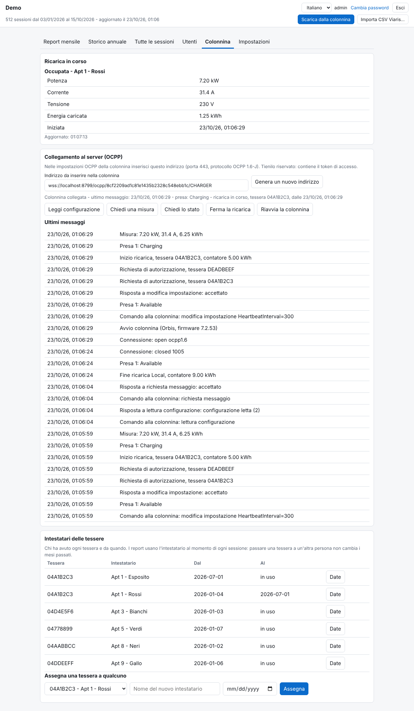
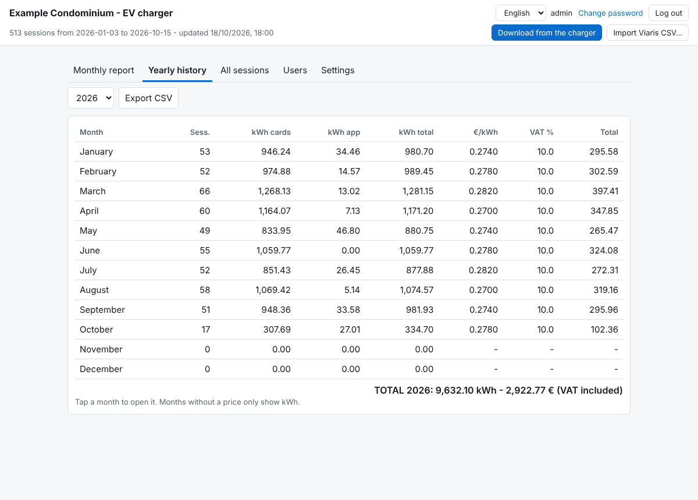
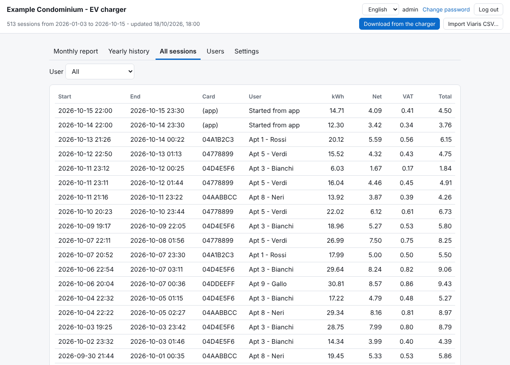
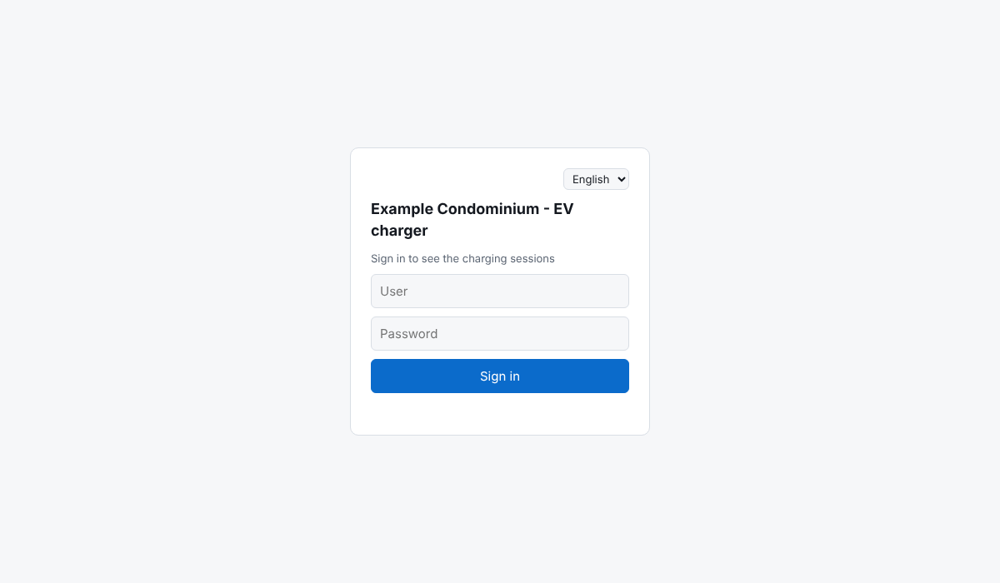

# Orbis Charge Report

[English](README.md) | **Italiano**

Una piccola webapp gratuita che scarica lo storico delle sessioni da una colonnina di ricarica **Orbis**, lo conserva per sempre e produce report mensili e annuali per ripartire i costi per tessera RFID, con prezzo al kWh e IVA. E' nata per i condomini in cui piu' persone usano la stessa colonnina e l'edificio deve dividere la bolletta. Funziona da telefono o da PC, senza programmi Windows, e gira sul piano gratuito di Cloudflare (un Worker e un database D1).

> Progetto amatoriale non ufficiale, non affiliato ne' approvato da Orbis o Viaris. I nomi dei prodotti sono usati solo per indicare la compatibilita'.

## Indice

- [Funzioni](#funzioni)
- [Schermate](#schermate)
- [Hardware provato](#hardware-provato)
- [Requisiti](#requisiti)
- [Installazione](#installazione)
- [Primo avvio](#primo-avvio)
- [Impostazioni](#impostazioni)
- [Come parla con la colonnina](#come-parla-con-la-colonnina)
- [Usarla con un'altra colonnina](#usarla-con-unaltra-colonnina)
- [Stato in tempo reale con OCPP](#stato-in-tempo-reale-con-ocpp-facoltativo)
- [Utenti e permessi](#utenti-e-permessi)
- [Prezzi, IVA e blocco del mese](#prezzi-iva-e-blocco-del-mese)
- [Importare i CSV di Viaris](#importare-i-csv-di-viaris)
- [Inviare i dati dall'esterno (API ingest)](#inviare-i-dati-dallesterno-api-ingest)
- [Segreti e variabili d'ambiente](#segreti-e-variabili-dambiente)
- [Backup](#backup)
- [Sviluppo in locale](#sviluppo-in-locale)
- [Problemi comuni](#problemi-comuni)
- [Note sulla sicurezza](#note-sulla-sicurezza)
- [Limiti](#limiti)
- [Licenza](#licenza)

## Funzioni

- **Scarico automatico** dalla colonnina ogni 6 ore, piu' un pulsante manuale. La colonnina conserva solo le ultime ~100 sessioni; il database le tiene tutte.
- **Report mensile e storico annuale** per tessera con imponibile, IVA e totale; stampa in PDF ed esportazione CSV.
- **Ripartizione che torna sempre**: gli importi sono divisi in centesimi con il metodo del resto maggiore, cosi' la somma delle singole ricariche e' uguale al totale della tessera.
- **Ricariche avviate da app** (senza tessera RFID) in una sezione separata, visibile solo agli utenti autorizzati.
- **Inserimento mensile del prezzo** (prezzo al kWh e IVA) che si blocca da solo quando il mese e' chiuso.
- **Report mensile via email**: quando salvi il prezzo di un mese, la ripartizione per tessera parte via email ai destinatari che scegli, con il PDF di tutte le sessioni allegato (tramite Resend).
- **PDF da scaricare**: gli utenti della colonnina possono scaricare il PDF delle proprie ricariche di un mese o di un anno intero.
- **Backup con un clic**: l'amministratore scarica dalla scheda Impostazioni un file `.sql` con tutto il database.
- **Utenti e permessi**: email e password, permessi per utente, link di invito monouso (anche via email con [Resend](https://resend.com)). Un "utente della colonnina" e' legato a una sola tessera e vede solo le proprie ricariche.
- **Pagina di prima configurazione**: crea l'amministratore e raccoglie tutto cio' che serve per raggiungere la colonnina.
- **Tutto configurabile dalla pagina web**: indirizzo della colonnina, credenziali, percorsi, formato della risposta e numeri di colonna, fuso orario, valuta, nome dell'imposta, titolo del sito, email.
- **Stato in tempo reale (OCPP 1.6)**: la scheda "Colonnina" mostra se la colonnina e' collegata, chi sta caricando, potenza, corrente, tensione ed energia in diretta. E' la colonnina che si collega al Worker; non le viene inviato nulla se non i comandi che premi tu (leggi configurazione, chiedi una misura, ferma la ricarica, riavvia).
- **Intestatari delle tessere con date**: registra chi ha avuto ogni tessera e da quando. I report usano l'intestatario al momento di ogni sessione: passare una tessera a un'altra persona non riscrive i mesi passati.
- **Elenco tessere sulla colonnina (Orbis)**: leggi, aggiungi, modifica, blocca, elimina e ripristina le tessere che la colonnina accetta, direttamente dalla pagina web. L'elenco viene salvato prima di ogni modifica e riletto per controllare.
- **Interfaccia in italiano e in inglese** con selettore della lingua (anche nella pagina di accesso, negli inviti e nelle email).
- Importazione facoltativa dei CSV per tessera esportati dal programma Viaris per desktop.

## Schermate

Tutte le schermate usano dati dimostrativi inventati.

**Report mensile** - totali per tessera, singole ricariche al clic, ricariche da app in una sezione a parte:


**Stato in diretta della colonnina** - collegamento, chi sta caricando, potenza ed energia in tempo reale, piu' il riquadro degli intestatari:



| Storico annuale | Tutte le sessioni |
|---|---|
|  |  |

| Utenti e permessi | Un utente della colonnina vede solo la sua tessera |
|---|---|
|  |  |

| Prima configurazione con prova di connessione | Impostazioni |
|---|---|
|  |  |

| Interfaccia in inglese | Accesso |
|---|---|
|  |  |

## Hardware provato

Sviluppata e usata con questa stazione (dati dalla schermata "Informazioni sulla Stazione" della stazione stessa):

| Voce | Valore |
| --- | --- |
| Versione firmware | 7.2.53 |
| Versione hardware | 8.0 |
| Firmware / hardware scheda di potenza | 3PH_FW_ORB_V06.3 / 3PH_HW_ORB_V6.2 |
| Firmware cortex | 003.005.010 (dic 2020) |
| Caratteristiche | trifase, RFID attivato, potenza di carica 22080 W, potenza limite 13800 W |

Altri modelli o versioni di firmware Orbis possono esporre le stesse pagine con colonne diverse: vedi [Usarla con un'altra colonnina](#usarla-con-unaltra-colonnina). Segnalazioni su altre configurazioni (che funzionano o no) sono benvenute come issue.

## Requisiti

- Node.js 18 o successivo e npm.
- Un account [Cloudflare](https://dash.cloudflare.com/sign-up) gratuito.
- Una colonnina la cui interfaccia web sia raggiungibile **da internet** in HTTP o HTTPS. Dai Worker di Cloudflare si possono raggiungere in modo affidabile solo le porte **80 e 443**.
  - Se la colonnina e' dietro un router con IP pubblico che cambia (per esempio un router con SIM), usa un nome DNS dinamico (DDNS) e un inoltro di porta.
  - Usa un nome host e non un indirizzo IP nudo: i Worker possono rifiutare le richieste verso IP diretti.
- Facoltativo: un account [Resend](https://resend.com) e un dominio mittente verificato, per mandare gli inviti via email.

## Installazione

```
git clone https://github.com/alexxandro87/orbis-charge-report.git
cd orbis-charge-report
npm install
npx wrangler login                          # si apre il browser, accedi a Cloudflare
cp wrangler.toml.example wrangler.toml
npx wrangler d1 create ricariche            # copia il database_id stampato dentro wrangler.toml
npx wrangler d1 execute ricariche --remote --file=schema.sql
npx wrangler secret put SETUP_CODE          # consigliato, vedi sotto
npx wrangler deploy                         # stampa https://orbis-charge-report.<tuo>.workers.dev
```

In PowerShell su Windows, se `npx` e' bloccato, usa `npx.cmd`.

**Dominio personalizzato (facoltativo):** togli il commento alla riga `routes` in `wrangler.toml` e inserisci il tuo nome, poi `npx wrangler deploy` di nuovo. Il dominio deve essere gia' nel tuo account Cloudflare.

**Perche' `SETUP_CODE`:** finche' l'amministratore non esiste, chiunque apra l'indirizzo del Worker potrebbe crearlo. Un codice di installazione (una stringa casuale lunga a tua scelta) viene chiesto nella pagina di configurazione e lo impedisce. Impostalo prima del primo accesso. Quando l'amministratore esiste la pagina di configurazione sparisce per sempre.

## Primo avvio

Apri l'indirizzo del Worker. In una installazione nuova compare la **pagina di prima configurazione**:

1. Inserisci il **codice di installazione** (se l'hai impostato).
2. Scegli **nome utente e password dell'amministratore** (almeno 8 caratteri).
3. Inserisci l'**indirizzo della colonnina** (per esempio `http://mia-colonnina.esempio-ddns.com`) e, se la colonnina chiede un accesso, utente e password HTTP Basic oppure un'intestazione extra.
4. Premi **Prova la connessione**: vedi se storico ed elenco tessere sono stati scaricati, quante righe sono state lette, la prima riga decodificata e la risposta grezza. Se le righe sono sbagliate, correggi i numeri di colonna piu' tardi nella scheda Impostazioni.
5. Imposta **titolo del sito**, **fuso orario** (per esempio `Europe/Rome`, `Europe/London`, `America/New_York`) e **simbolo della valuta**.
6. Facoltativo: una **chiave API di Resend** e un **indirizzo mittente** per inviare gli inviti via email.
7. Premi **Crea l'amministratore e termina**. Sei gia' dentro.

Poi premi una volta **Scarica dalla colonnina** (da quel momento va da solo ogni 6 ore) e ogni mese inserisci nella scheda Report mensile il prezzo al kWh e l'IVA della bolletta.

## Impostazioni

Sono tutte nella scheda **Impostazioni** (solo amministratore) e vengono salvate nel database. I valori salvati li' prevalgono sulle variabili d'ambiente.

| Impostazione | Predefinito | Significato |
| --- | --- | --- |
| Indirizzo della colonnina (URL) | vuoto | Indirizzo di base, per esempio `http://colonnina.example.com`. Obbligatorio. |
| Nome utente / Password (HTTP Basic) | vuoti | Inviati come `Authorization: Basic ...` se e' impostato un nome utente. La password e' salvata nel database e non viene mai rimandata al browser. |
| Nome / valore intestazione extra | vuoti | Un'altra intestazione in ogni richiesta, per esempio `Authorization` / `Bearer xxxx` o `Cookie` / `session=xxxx`. |
| Percorso dello storico | `/modules/modulator/historic?from=0&to=-1` | Percorso (e query) che restituisce lo storico delle sessioni. |
| Percorso elenco tessere | `/modules/tags?level=file` | Percorso che restituisce l'elenco delle tessere. Vuoto = salta (le tessere mostrano solo il codice). |
| Timeout | 20 s | Per ogni richiesta. |
| Scarica automaticamente | attivo | Se l'esecuzione programmata scarica. L'orario e' in `wrangler.toml`. |
| Campo JSON con il CSV | `body` | La risposta dello storico e' JSON e questo campo contiene il testo CSV. Vuoto = la risposta e' gia' CSV. |
| Separatore di colonna | `,` | Separatore del CSV dello storico. |
| Righe di intestazione da saltare | 0 | Righe da ignorare in cima al CSV. |
| Colonne (inizio, fine, tessera, tipo, contatore iniziale, contatore finale) | 0, 10, 7, 8, 9, 13 | Numeri di colonna a partire da 0 in una riga dello storico. Gli orari sono epoch in secondi, i contatori in Wh. |
| Elenco tessere: separatore / righe da saltare / colonna tessera / colonna nome | `;` / 1 / 0 / 2 | Struttura del testo dell'elenco tessere. |
| Titolo del sito | `EV Charger` | Mostrato nelle pagine, nei report e nelle email. |
| Fuso orario | `Europe/Rome` | Nome IANA. Decide a quale mese appartiene una sessione e quando i prezzi si bloccano. |
| Simbolo della valuta | `€` | Mostrato accanto ai totali. |
| Nome dell'imposta | vuoto | Vuoto = "IVA" in italiano, "VAT" in inglese. |
| Chiave API Resend / mittente | vuoti | Attivano le email (inviti e report mensili). La chiave non viene mai rimandata al browser. |
| Destinatari del report mensile (A / CC) | vuoti | Indirizzi separati da virgola che ricevono la ripartizione con il PDF quando salvi un prezzo. A vuoto = nessuna email del report. |

## Come parla con la colonnina

Sul firmware provato, l'interfaccia web della colonnina risponde a due semplici richieste HTTP GET, ed e' tutto cio' che questa app usa:

- `GET /modules/modulator/historic?from=0&to=-1` restituisce un JSON come `{"body": "<una riga CSV per sessione>"}`. Ogni riga ha campi separati da virgola; l'app legge la colonna 0 (inizio, epoch in secondi), 7 (codice tessera), 8 (tipo di avvio, per esempio `rfid_tag` o `app`; le ricariche avviate da app sono quelle senza tessera), 9 (contatore di energia all'inizio, Wh), 10 (fine, epoch in secondi) e 13 (contatore di energia alla fine, Wh). Energia della sessione = contatore finale - contatore iniziale.
- `GET /modules/tags?level=file` restituisce testo semplice: una prima riga con la versione dell'elenco, poi una tessera per riga, separata da `;`, con il codice tessera nella colonna 0 e il nome dell'intestatario nella colonna 2.

Le sessioni sono salvate una sola volta (chiave primaria = ora di inizio + contatore iniziale), quindi riscaricare lo stesso storico non crea doppioni. I codici tessera si confrontano senza distinguere maiuscole e minuscole. Se un'importazione Viaris e uno scarico dalla colonnina descrivono la stessa sessione, il doppione viene tolto.

## Stato in tempo reale con OCPP (facoltativo)

La colonnina puo' comunicare in diretta con il tuo Worker tramite OCPP 1.6-J. Il Worker usa un piccolo Durable Object (con SQLite, disponibile nel piano gratuito) per la connessione.

1. Tieni nel tuo `wrangler.toml` i blocchi `[[durable_objects.bindings]]` e `[[migrations]]` di `wrangler.toml.example` e pubblica di nuovo. La colonnina deve raggiungere il Worker in `wss://` sulla porta 443, quindi serve un dominio personalizzato.
2. Apri la scheda **Colonnina** come amministratore e copia l'indirizzo mostrato (contiene un token segreto).
3. Nelle impostazioni OCPP della colonnina inserisci quell'indirizzo, protocollo OCPP 1.6-J. Entro un minuto la scheda mostra "Colonnina collegata".

Cosa fa: mostra stato e misure in diretta, elenca gli ultimi messaggi e permette all'amministratore di leggere la configurazione, chiedere una misura o lo stato, fermare la ricarica in corso e riavviare una colonnina a riposo. Cosa non fa: non invia mai una lista di tessere ne' profili di carica, e i report mensili continuano a partire dallo storico scaricato. Quando la colonnina chiede al server di autorizzare una tessera, viene accettata solo una tessera presente nell'elenco scaricato dalla colonnina e accettata li'; le sconosciute, quelle tolte dalla colonnina e quelle bloccate, scadute o non valide sono rifiutate. Il permesso "live" permette a un gestore di vedere chi sta caricando. "Genera un nuovo indirizzo" invalida il token precedente.

### Tessere sulla colonnina

Il riquadro "Tessere sulla colonnina" (scheda Colonnina, amministratore) mostra le tessere accettate dalla colonnina e permette di aggiungerle, modificarle (nome, scadenza, stato accettata / bloccata / scaduta / non valida) ed eliminarle, oppure di rimettere la lista salvata prima dell'ultima modifica. Usa l'interfaccia web di Orbis, non OCPP: l'elenco si legge dal **Percorso elenco tessere** delle Impostazioni (deve contenere `level=file`), si riscrive allo stesso indirizzo e si salva con `level=save`. Prima di ogni modifica l'elenco attuale viene conservato nel database e, dopo la scrittura, viene riletto per controllare che la colonnina l'abbia tenuto (la colonnina tiene nomi fino a 25 caratteri). Le tessere vengono copiate anche nella tabella locale, che alimenta i report e il controllo OCPP, e una tessera aggiunta con "Intestatario dal" fa partire il periodo dell'intestatario da quel giorno. Funziona solo con il formato elenco tessere di Orbis (`codice;scadenza;nome;stato`).

### Intestatari delle tessere

Il riquadro "Intestatari delle tessere" (scheda Colonnina, amministratore) elenca chi ha avuto ogni tessera e da/fino a quale data. I nomi che arrivano dalla colonnina creano il primo periodo in automatico. Per passare una tessera a un'altra persona scegli la tessera, scrivi il nome e la data di inizio: il periodo precedente si chiude quel giorno. Le date di un periodo si correggono con "Date". I periodi che modifichi non vengono mai sovrascritti dagli scarichi successivi. Un utente della colonnina legato a una tessera vede solo le sessioni dell'intestatario attuale.

## Usarla con un'altra colonnina

Nessun formato e' scritto nel codice in modo rigido. Se la tua colonnina (o il tuo firmware) restituisce lo storico in modo diverso, apri **Impostazioni**, premi **Prova la connessione**, leggi la risposta grezza mostrata e cambia:

- i percorsi, se gli indirizzi sono diversi;
- il campo JSON (o lascialo vuoto se la risposta e' direttamente CSV);
- il separatore, le righe di intestazione da saltare e i numeri di colonna.

Restano solo queste ipotesi: una sessione per riga, inizio e fine in epoch secondi, contatori di energia in Wh. Se il tuo dispositivo riporta altro, apri una issue con un esempio (senza dati personali) oppure invia una pull request; il parser sta nelle due piccole funzioni `parseStorico` e `parseTessere` in `src/index.js`.

## Utenti e permessi

L'amministratore vede e fa tutto. Gli altri utenti si creano nella scheda **Utenti** inserendo un indirizzo email e scegliendo:

- **Gestione**: decidi cosa puo' fare l'utente: vedere il report mensile, lo storico annuale, tutte le sessioni; inserire prezzo e IVA; stampare ed esportare; scaricare dalla colonnina e importare CSV; vedere le ricariche avviate da app.
- **Utente della colonnina**: legato a una tessera; vede solo le sessioni di quella tessera (mese per mese, con gli importi) e nient'altro, e puo' scaricarle in PDF.

Con **Invia invito** parte via email un link personale e monouso, valido 48 ore, per scegliere la password. Se l'email non e' configurata o l'invio fallisce, la pagina mostra il link da mandare a mano. "Reimposta" / "Reinvia" crea un nuovo link. Ogni utente puo' cambiare la propria password dall'intestazione.

## Prezzi, IVA e blocco del mese

Per ogni mese inserisci prezzo al kWh e IVA dalla bolletta. Se nelle Impostazioni ci sono i destinatari dei report, salvando il prezzo parte la ripartizione per tessera via email con il PDF di tutte le sessioni (l'amministratore puo' rimandarla con **Reinvia il report via email**). Il prezzo di un mese si puo' inserire e correggere fino alla fine del mese successivo, poi si blocca: per esempio il prezzo di ottobre si puo' cambiare fino al 30 novembre e dal 1 dicembre e' bloccato, per tutti, amministratore compreso. Un mese senza prezzo si puo' ancora compilare una volta. Lo scopo e' che i report chiusi non cambino piu'.

Correzione d'emergenza di un mese bloccato, da terminale:

```
npx wrangler d1 execute ricariche --remote --command "UPDATE prezzi SET eur_kwh=0.2531, iva=10 WHERE anno=2026 AND mese=10"
```

## Importare i CSV di Viaris

Se prima usavi il programma Viaris per desktop, premi **Importa CSV Viaris...** e seleziona le sue esportazioni per tessera (un file per tessera, piu' uno chiamato `U ...` per le ricariche avviate da app). La tessera si riconosce dalla prima parola del nome del file, quindi scarica prima dalla colonnina (e' da li' che arriva l'elenco tessere). L'importazione si puo' ripetere e non crea doppioni. Le date di quei file sono lette come ora locale del fuso orario configurato.

## Inviare i dati dall'esterno (API ingest)

Se il Worker non riesce proprio a raggiungere la colonnina, un computer che la raggiunge puo' inviare le risposte grezze al suo posto. Manda le due risposte come testo al Worker con le credenziali di un utente che puo' scaricare:

```
curl -u admin:LA_TUA_PASSWORD https://IL-TUO-WORKER/api/ingest \
  -H "content-type: application/json" \
  -d "{\"storico\": $(jq -Rs . < storico.txt), \"tessere\": $(jq -Rs . < tessere.txt)}"
```

`storico.txt` e `tessere.txt` sono i corpi esatti restituiti dai due indirizzi della colonnina. Vengono interpretati con le stesse impostazioni di un normale scarico.

## Segreti e variabili d'ambiente

Non serve impostare nulla se non cio' che vuoi. Meglio usare la pagina web; queste servono per automazioni o se non vuoi un valore nel database.

| Nome | Tipo | Scopo |
| --- | --- | --- |
| `SETUP_CODE` | segreto | Protegge la pagina di prima configurazione. Consigliato. |
| `CHARGER_URL`, `TIMEZONE`, `CURRENCY`, `SITE_TITLE`, `MAIL_FROM` | variabile | Valori predefiniti, sostituiti da quelli salvati. |
| `CHARGER_USER`, `CHARGER_PASSWORD`, `RESEND_API_KEY` | segreto | Valori predefiniti, sostituiti da quelli salvati. |
| `APP_PASSWORD` | segreto | Compatibilita': crea l'utente `admin` con questa password e salta la pagina di configurazione. |

Un segreto si imposta con `npx wrangler secret put NOME`.

## Backup

Dalla pagina: **Impostazioni > Backup del database > Scarica backup (.sql)** (solo amministratore). Da terminale:

```
npx wrangler d1 export ricariche --remote --output backup.sql
```

Entrambi i file si ripristinano con `npx wrangler d1 execute ricariche --remote --file=backup.sql`.

Pianificalo con cron o con l'Utilita' di pianificazione. D1 conserva anche 7 giorni di storia (`npx wrangler d1 time-travel restore ricariche --timestamp=<data ISO>`). Attenzione: l'esportazione contiene la password della colonnina e la chiave Resend salvate: tienila riservata.

## Sviluppo in locale

```
cp .dev.vars.example .dev.vars
npx wrangler d1 execute ricariche --local --file=schema.sql
npx wrangler dev
```

## Problemi comuni

| Sintomo | Causa probabile e rimedio |
| --- | --- |
| "timeout after 20 s" o errore di rete | Il Worker non raggiunge la colonnina: controlla il nome DDNS, l'inoltro di porta sul router e che usi la porta 80 o 443. Prova l'indirizzo da un'altra rete. |
| "HTTP 401" / "HTTP 403" | La colonnina chiede un accesso: imposta utente e password HTTP Basic o un'intestazione extra. |
| "The history response is not JSON" | La risposta e' direttamente CSV: svuota l'impostazione del campo JSON. |
| Righe lette ma "scartate" molte, oppure tessere o energia sbagliate | I numeri di colonna sono diversi: usa Prova la connessione, leggi la risposta grezza e correggi le colonne. |
| Le sessioni finiscono nel mese sbagliato | Fuso orario impostato male. |
| Email di invito non inviata | Controlla la chiave Resend, che il dominio mittente sia verificato e il testo dell'errore nella scheda Utenti. Il link viene sempre mostrato, cosi' puoi mandarlo a mano. |
| La pagina di configurazione non compare | Esiste gia' un amministratore (oppure e' impostato `APP_PASSWORD`). |

## Note sulla sicurezza

- Le password sono protette con PBKDF2-SHA-256; il numero di iterazioni e' volutamente basso (5000) per restare nel limite di CPU del piano gratuito. Usa password lunghe.
- L'accesso e' limitato nei tentativi (5 ogni 10 minuti per nome utente). I cookie di sessione sono `HttpOnly`, `Secure`, `SameSite=Strict`; ogni accesso riceve un token firmato diverso.
- **Esci** annulla la sessione anche sul server (il token viene revocato, non solo cancellato il cookie). Cambiare password o eliminare un utente chiude tutte le sue sessioni.
- Ogni risposta ha intestazioni di sicurezza: l'HTTP semplice viene rediretto su HTTPS, HSTS, `X-Frame-Options: DENY` e `frame-ancestors 'none'` (il sito non si puo' incorporare in altri siti), `X-Content-Type-Options: nosniff`, `Referrer-Policy: no-referrer` (i link di invito non escono mai).
- L'autenticazione HTTP Basic e' accettata solo su `/api/ingest`, mai per le pagine.
- La password della colonnina e la chiave Resend sono salvate nel database D1 (e non vengono piu' mostrate nella pagina). Se non e' accettabile, impostale come segreti del Worker.
- Il collegamento alla colonnina e' spesso in HTTP semplice, quindi le credenziali inviate non sono cifrate. Se la colonnina lo permette, usa un account dedicato in sola lettura.
- E' stata scritta per un piccolo gruppo privato. Rivedila prima di esporla a utenti non fidati.

## Limiti

- Lo stato in tempo reale usa un solo collegamento (una colonnina); l'elenco tessere si gestisce solo con l'interfaccia web di Orbis (vedi "Tessere sulla colonnina").
- I report riguardano una sola colonnina e un solo prezzo al mese.
- L'intervallo dello scarico programmato si imposta in `wrangler.toml` (predefinito ogni 6 ore).
- Commenti e nomi interni del codice sono in parte in italiano per ragioni storiche; interfaccia e messaggi sono bilingue.

## Licenza

Copyright (C) 2026 Alessandro Pomponi. Rilasciato con licenza **GNU Affero General Public License v3.0 o successiva** (AGPL-3.0-or-later), vedi [LICENSE](LICENSE).

In breve: puoi usare, studiare, modificare e condividere questo software, anche per il tuo edificio o la tua attivita'. Se distribuisci una versione modificata, o la fai usare ad altri tramite rete (per esempio ospitandola come servizio), devi mettere il codice sorgente della tua versione modificata a disposizione di quegli utenti con la stessa licenza (sezione 13). Usarla senza modifiche per il proprio condominio non richiede altro che mantenere gli avvisi di licenza e di copyright. Questo riassunto non e' una consulenza legale: vale il testo della licenza.
