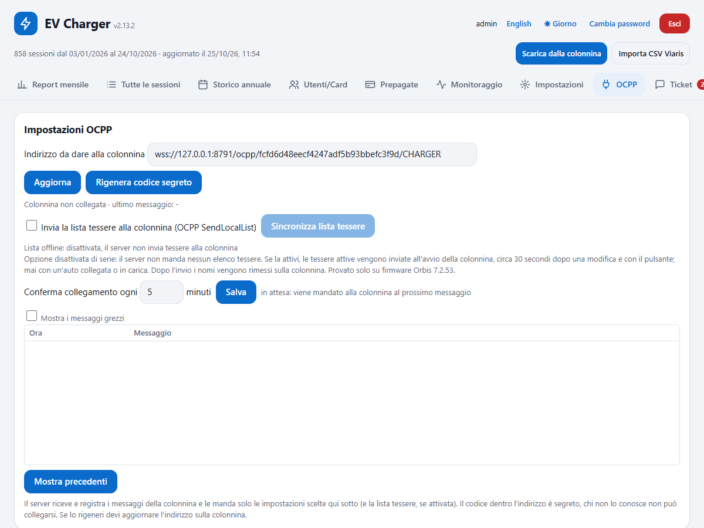
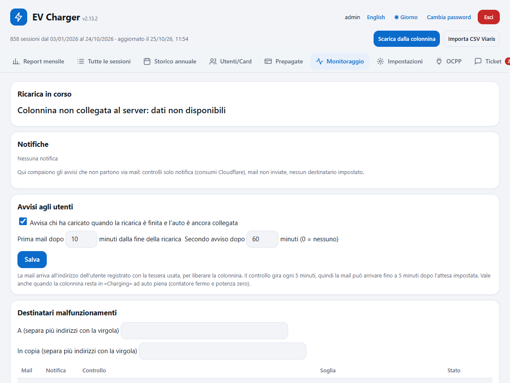
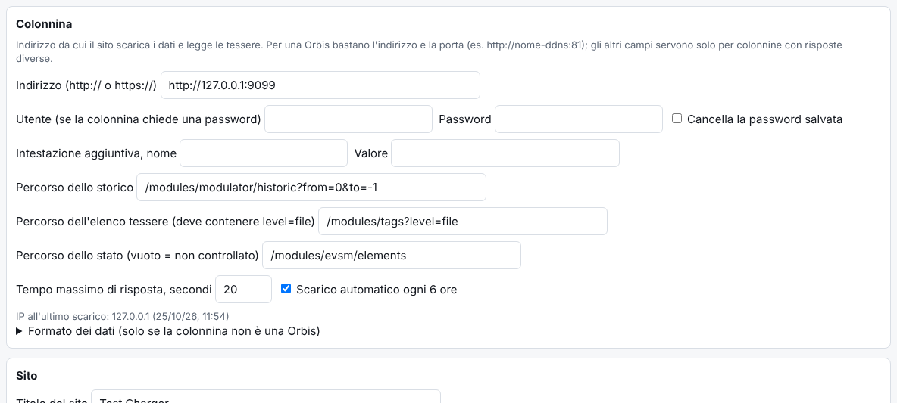
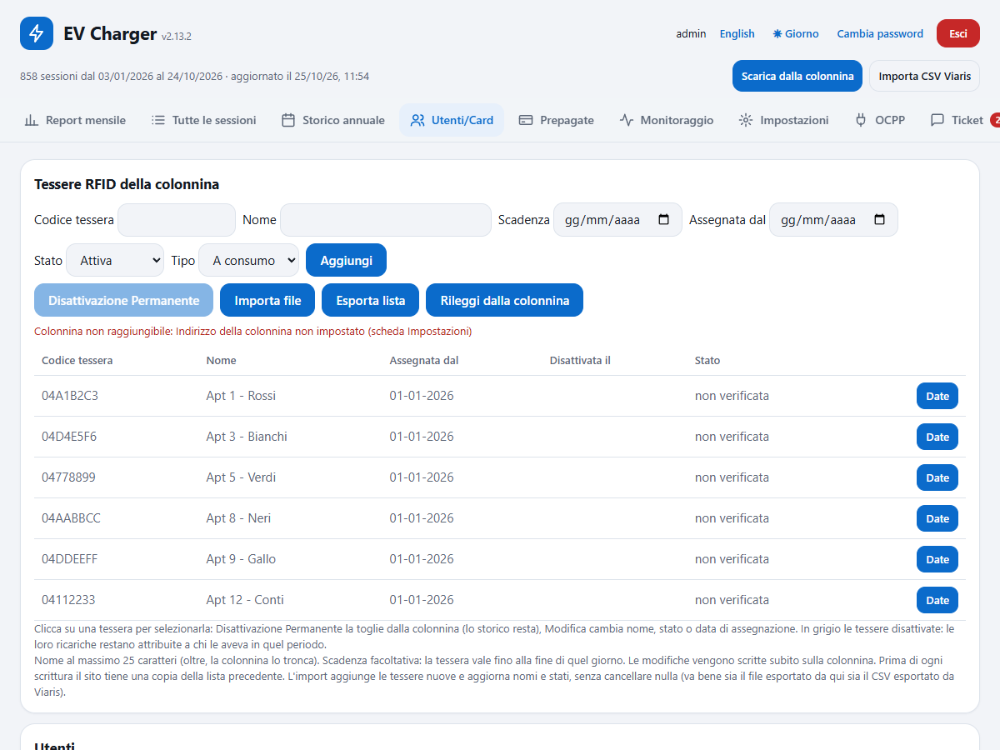
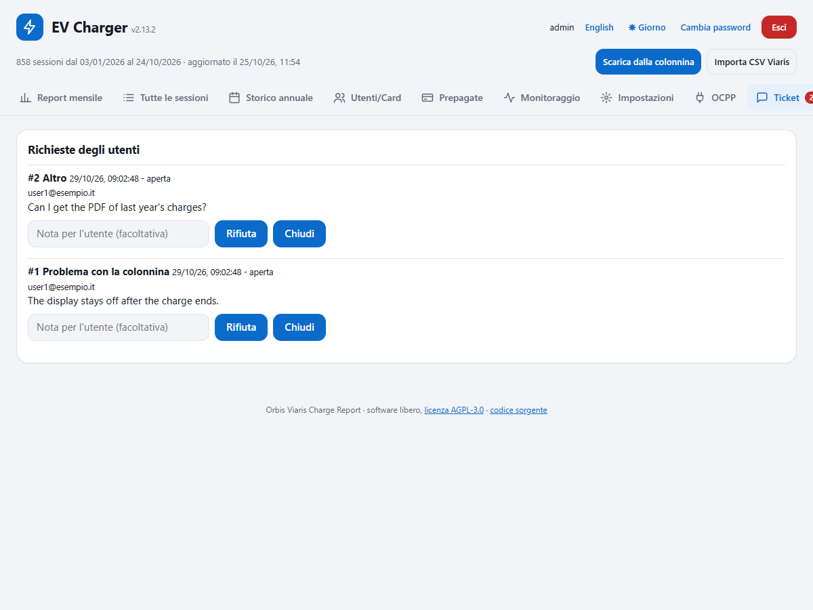
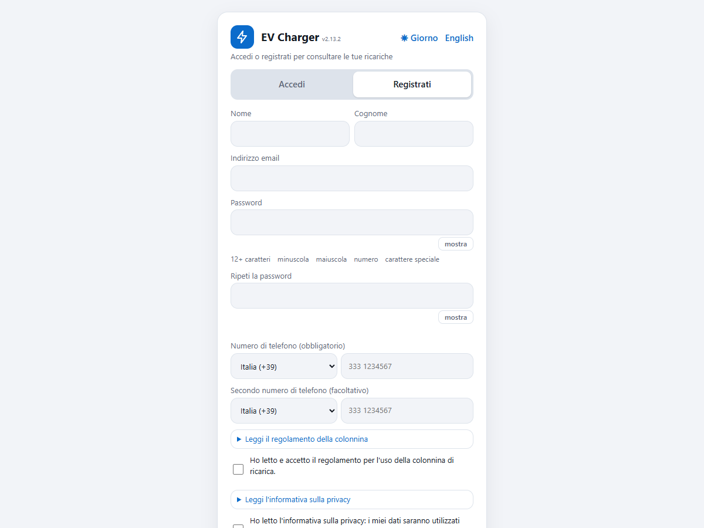
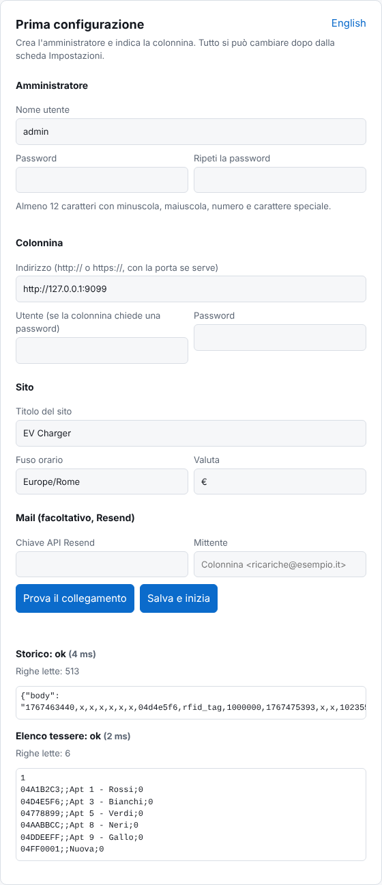
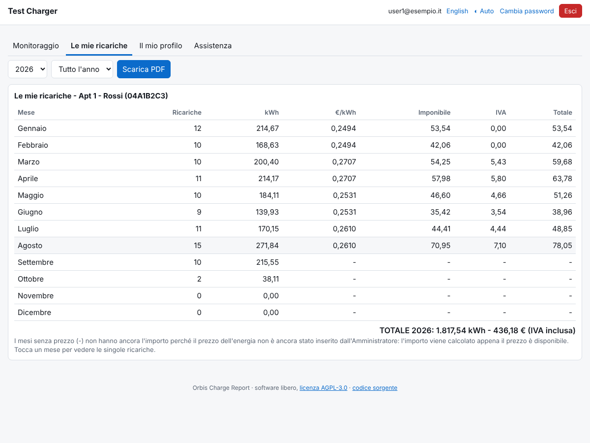
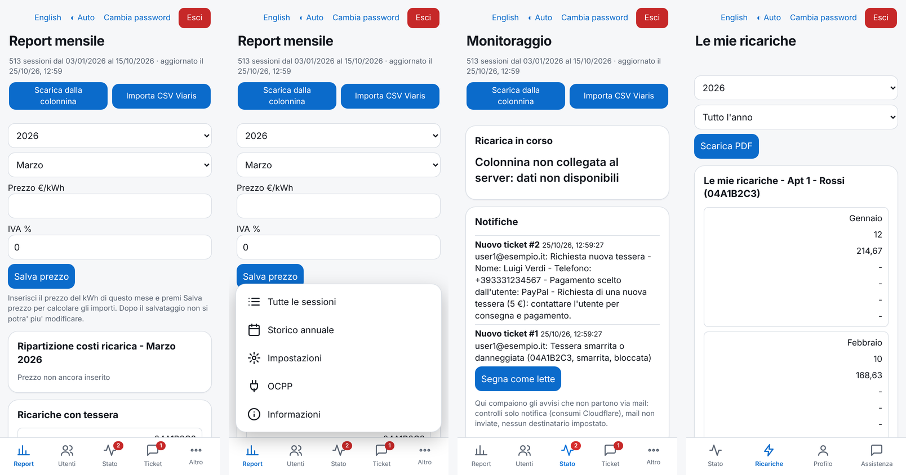

# Orbis Viaris Charge Report

[English](README.md) | **Italiano**

Una webapp libera che scarica lo storico delle ricariche da una colonnina **Orbis Viaris**, lo conserva per sempre e produce i report mensili e annuali di ripartizione dei costi per tessera RFID, con prezzo al kWh e IVA. È nata per i condomini dove più persone usano la stessa colonnina e la bolletta va divisa. Gira sul piano gratuito di Cloudflare (un Worker, un database D1, un Durable Object), funziona da telefono e da PC, e include un piccolo server OCPP 1.6, la registrazione autonoma degli utenti, i ticket di assistenza, il monitoraggio con avvisi via mail e la cifratura dei dati personali.

> Progetto non ufficiale, non affiliato né approvato da Orbis o Viaris. I nomi dei prodotti sono usati solo per descrivere la compatibilità. **Provato solo su firmware Orbis 7.2.53** (vedi [Hardware provato](#hardware-provato)).

Nel codice non c'è nulla di una installazione specifica: indirizzo della colonnina, titolo, fuso orario, valuta, mail, costo della tessera, testi legali e contatto si inseriscono dalla pagina web. Il regolamento d'uso e l'informativa privacy **non** sono forniti: li scrive chi installa il sito (scheda Impostazioni).

## Indice

- [Funzioni](#funzioni)
- [Schermate](#schermate)
- [Hardware provato](#hardware-provato)
- [Requisiti](#requisiti)
- [Installazione](#installazione)
- [Primo avvio](#primo-avvio)
- [Impostazioni](#impostazioni)
- [Come parla con la colonnina](#come-parla-con-la-colonnina)
- [OCPP: stato live, impostazioni e lista tessere facoltativa](#ocpp-stato-live-impostazioni-e-lista-tessere-facoltativa)
- [Tessere sulla colonnina e intestatari](#tessere-sulla-colonnina-e-intestatari)
- [Utenti: inviti, registrazione, profilo](#utenti-inviti-registrazione-profilo)
- [Assistenza (ticket)](#assistenza-ticket)
- [Monitoraggio, notifiche e avvisi](#monitoraggio-notifiche-e-avvisi)
- [Consumi Cloudflare](#consumi-cloudflare)
- [Cifratura dei dati personali](#cifratura-dei-dati-personali)
- [Prezzi, IVA e blocco del mese](#prezzi-iva-e-blocco-del-mese)
- [Importare i CSV di Viaris](#importare-i-csv-di-viaris)
- [Spingere i dati da fuori (API ingest)](#spingere-i-dati-da-fuori-api-ingest)
- [Secret e variabili](#secret-e-variabili)
- [Backup](#backup)
- [Sviluppo in locale](#sviluppo-in-locale)
- [Problemi frequenti](#problemi-frequenti)
- [Note di sicurezza](#note-di-sicurezza)
- [Limiti](#limiti)
- [Licenza](#licenza)

## Funzioni

- **Scarico automatico** dalla colonnina ogni 6 ore, più il pulsante manuale. La colonnina tiene solo le ultime ~100 sessioni; il database tiene tutto.
- **Report mensile e storico annuale** per tessera con imponibile, IVA e totale; stampa, CSV, PDF via mail.
- **Ripartizione che torna**: gli importi sono divisi in centesimi col metodo del resto maggiore, così la somma delle singole ricariche coincide sempre con il totale della tessera.
- **Ricariche avviate da app** (senza tessera) in una sezione a parte, visibile solo a chi ha il permesso.
- **Prezzo mensile** (prezzo al kWh e IVA); una volta salvato, il mese è bloccato.
- **Report mensile via mail** con il PDF di tutte le sessioni allegato (Resend), ai destinatari che scegli. Ogni utente della colonnina riceve anche una mail personale con i suoi importi.
- **Bot Telegram** (facoltativo): avvisi di servizio agli utenti che danno il consenso (riepilogo a fine ricarica e promemoria, importi del mese, esito delle richieste, tessera riattivata), fino a due chat per account, e comandi di assistenza (`/smarrita`, `/danneggiata`, `/problema`, `/richieste`).
- **Utenti e permessi**: amministratore, gestori con permessi per funzione, utenti della colonnina legati a una o più tessere che vedono solo le proprie ricariche e le scaricano in PDF.
- **Registrazione autonoma**: gli utenti si registrano da soli (password forte, telefoni, accettazione di regolamento e informativa con l'edizione registrata), confermano l'email e vengono attivati quando l'amministratore abbina la tessera. La scheda "Il mio profilo" permette di cambiare o revocare i consensi.
- **Assistenza (ticket)**: tessera smarrita o danneggiata (bloccata subito sulla colonnina), richiesta di nuova tessera con costo e metodi di pagamento configurabili (PayPal.me, Satispay, Revolut, contanti), correzione dei dati, cancellazione di dati o utenza, problemi con la colonnina. L'amministratore approva o rifiuta; l'utente riceve l'esito per mail.
- **Stato live (OCPP 1.6)**: chi sta caricando, potenza, corrente, tensione ed energia in tempo reale; log leggibile delle ultime 48 ore (100 righe alla volta, «Mostra precedenti» per il resto); comandi di sola lettura, stop ricarica e riavvio; alcune impostazioni della colonnina modificabili dalla pagina.
- **Lista tessere offline via OCPP, facoltativa e DISATTIVATA di serie**: se attivata, il server manda alla colonnina l'elenco delle tessere attive (SendLocalList) così continuano a funzionare anche senza internet.
- **Tessere sulla colonnina**: lettura, aggiunta, modifica, blocco, eliminazione, import, export e ripristino delle tessere accettate dalla colonnina, dalla pagina. I nomi vengono rimessi dopo che la colonnina riscrive il proprio elenco.
- **Intestatari con date**: i report usano chi aveva la tessera al momento di ogni sessione, così passare una tessera a un altro non riscrive i mesi passati.
- **Monitoraggio**: 24 controlli (connessione, presa e ricariche, tessere, impostazioni, sito e sicurezza), ognuno spento finché non lo accendi, con soglie, mail all'inizio e alla fine del problema, notifiche nel sito e storico degli episodi.
- **Avvisi agli utenti**: a fine ricarica l'utente riceve un riepilogo (orari, durata, kWh; costo e credito residuo per le prepagate) e, finché l'auto resta collegata, promemoria per liberare la colonnina.
- **Tessere prepagate**: un credito in euro scalato con un prezzo per tessera; a credito esaurito la tessera viene bloccata e la ricarica fermata da remoto.
- **Archivio delle ricariche**: esportazione cifrata di un periodo in uno zip con visualizzatore HTML offline, ed eliminazione dei mesi esportati per liberare spazio.
- **Cifratura dei dati personali** (AES-256-GCM, chiave in un secret del Worker) e backup cifrato dalla pagina.
- **Consumi Cloudflare**: richieste, righe D1, uso OCPP e spazio rispetto ai limiti del piano gratuito, con riepilogo mensile e avviso a ridosso del limite.
- **Interfaccia in italiano e inglese**, tema giorno / notte / automatico, niente scorrimento orizzontale, tabelle che diventano schede su telefono.
- **Aspetto da app sul telefono** (fino a 700 px di larghezza): barra delle schede in basso con icone (le schede in più dell'admin vanno nel menu "Altro"), titolo della scheda aperta in alto, campi e pulsanti più grandi.
- **Aspetto pulito con un'icona per ogni sezione**: riquadri e campi arrotondati, il blu come colore del sito, un marchio blu accanto al titolo. Sul computer l'intestazione scorre via e la barra delle schede, con le icone, resta ferma in alto.
- **Versione accanto al titolo** (per esempio `v2.3.1`, da `package.json`), per vedere a colpo d'occhio quale release gira su un sito; da telefono compare sotto i collegamenti in alto.
- **Pagina di prima configurazione** e **tutto configurabile dalla pagina web**.
- Import facoltativo degli export CSV per tessera del programma Viaris.

## Schermate

Tutte le schermate usano dati inventati.

| Report mensile | Scheda OCPP: stato live, impostazioni e lista tessere facoltativa |
|---|---|
|  |  |

| Monitoraggio (amministratore) | Impostazioni |
|---|---|
|  |  |

| Utenti | Assistenza (utente) e ticket (amministratore) |
|---|---|
|  |  |

| Accesso e registrazione | Prima configurazione |
|---|---|
|  |  |

| Interfaccia inglese | Un utente della colonnina vede solo le proprie tessere |
|---|---|
|  |  |

| Da telefono: report mensile, menu "Altro", monitoraggio, le ricariche di un utente |
|---|
|  |

## Hardware provato

Sviluppata e usata con questa colonnina (dati della schermata "Informazioni stazione" della colonnina stessa):

| Voce | Valore |
| --- | --- |
| Versione firmware | **7.2.53** (l'unica provata) |
| Versione hardware | 8.0 |
| Firmware / hardware scheda di potenza | 3PH_FW_ORB_V06.3 / 3PH_HW_ORB_V6.2 |
| Firmware Cortex | 003.005.010 (dic 2020) |
| Caratteristiche | trifase, RFID, potenza di ricarica 22080 W, limite 13800 W |

Altri modelli Orbis o altre versioni del firmware potrebbero comportarsi diversamente, soprattutto con la lista tessere offline (SendLocalList) e le pagine dell'elenco tessere. Segnalazioni di altre configurazioni funzionanti (o no) sono benvenute come issue.

## Requisiti

- Node.js 18 o più recente e npm.
- Un account [Cloudflare](https://dash.cloudflare.com/sign-up) gratuito.
- Una colonnina con interfaccia web raggiungibile **da internet** in HTTP o HTTPS (per esempio con un nome DDNS e un inoltro di porta sul router). I Worker raggiungono anche porte non standard (es. `:81`) su un nome host; evita gli indirizzi IP nudi.
- Per la parte OCPP: un dominio personalizzato su Cloudflare (la colonnina si collega in `wss://` sulla porta 443).
- Facoltativo: un account [Resend](https://resend.com) con dominio verificato, per le mail.

## Installazione

```
git clone https://github.com/alexxandro87/orbis-viaris-charge-report.git
cd orbis-viaris-charge-report
npm install
npx wrangler login                          # apre il browser: accedi a Cloudflare
cp wrangler.toml.example wrangler.toml
npx wrangler d1 create ricariche            # copia il database_id stampato dentro wrangler.toml
npx wrangler d1 execute ricariche --remote --file=schema.sql
npx wrangler secret put SETUP_CODE          # consigliato, vedi sotto
npx wrangler deploy                         # stampa https://orbis-viaris-charge-report.<tuo>.workers.dev
```

Su Windows PowerShell, se `npx` è bloccato, usa `npx.cmd`.

**Dominio personalizzato:** togli il `#` dalla riga `routes` di `wrangler.toml`, metti il tuo nome host e rilancia `npx wrangler deploy`. Il dominio deve già essere sul tuo account Cloudflare.

**`SETUP_CODE`:** finché l'amministratore non esiste, chiunque apra l'indirizzo del Worker potrebbe crearlo. Un codice di configurazione (una stringa lunga a tua scelta) viene chiesto nella pagina di primo avvio e lo impedisce. Impostalo prima della prima visita. Creato l'amministratore, la pagina di configurazione sparisce per sempre.

## Primo avvio

Apri l'indirizzo del Worker. Su una installazione nuova compare la **pagina di prima configurazione**:

1. Scegli il **nome utente dell'amministratore** e una password forte (almeno 12 caratteri con minuscola, maiuscola, numero e carattere speciale). Inserisci il codice di configurazione se l'hai impostato.
2. Inserisci l'**indirizzo della colonnina** (per esempio `http://mia-colonnina.esempio-ddns.it:81`) e, se la colonnina chiede un accesso, utente e password.
3. Premi **Prova il collegamento**: vedi se storico ed elenco tessere si leggono e un campione della risposta.
4. Imposta **titolo del sito**, **fuso orario** e **valuta**; se vuoi, chiave Resend e mittente per le mail.
5. Premi **Salva e inizia**. Sei dentro.

Poi premi **Scarica dalla colonnina** una volta (dopo va da solo ogni 6 ore), apri **Impostazioni** per completare il resto (destinatari del report mensile, costo tessera, contatto, testi legali) e ogni mese inserisci prezzo al kWh e IVA della bolletta nella scheda Report mensile.

## Impostazioni

Tutte nella scheda **Impostazioni** (solo amministratore), salvate nel database. I valori salvati lì vincono sulle variabili d'ambiente.

| Impostazione | Predefinito | Significato |
| --- | --- | --- |
| Indirizzo della colonnina | vuoto | Indirizzo base con porta, es. `http://colonnina.esempio.it:81`. Obbligatorio. |
| Utente / Password | vuoti | Inviati come HTTP Basic se c'è l'utente. La password non torna mai al browser. |
| Intestazione aggiuntiva | vuota | Un'intestazione in più su ogni richiesta alla colonnina. |
| Percorso dello storico | `/modules/modulator/historic?from=0&to=-1` | Percorso che restituisce lo storico delle sessioni. |
| Percorso dell'elenco tessere | `/modules/tags?level=file` | Percorso dell'elenco tessere (deve contenere `level=file` per la gestione tessere). |
| Percorso dello stato | `/modules/evsm/elements` | Serve per rimettere i nomi delle tessere solo a presa libera. Vuoto = non controllato. |
| Tempo massimo di risposta | 20 s | Per richiesta. |
| Scarico automatico | acceso | Se lo scarico pianificato ogni 6 ore scarica. |
| Formato dei dati (campo JSON, separatore, righe da saltare, colonne) | valori Orbis | Solo per colonnine con uno storico diverso. |
| Token del bot / segreto del webhook (Telegram) | vuoti | Da BotFather / una stringa lunga a caso (la pagina Impostazioni la genera); servono entrambi per i messaggi e il bot. |
| Titolo del sito | `EV Charger` | Pagine, mail, PDF. |
| Fuso orario | `Europe/Rome` | Nome IANA. Decide a quale mese appartiene una sessione. |
| Valuta | `€` | Accanto agli importi. |
| Etichetta dell'imposta | vuota | Vuota = "IVA" / "VAT". |
| Costo della tessera | 0 | Mostrato a chi richiede una tessera (0 = non mostrato). |
| Contatto del gestore | vuoto | Nel profilo e nella scheda Informazioni. |
| Identificativo della colonnina | `CHARGER` | Ultima parte dell'indirizzo OCPP. |
| Chiave Resend / mittente | vuoti | Attivano tutte le mail. |
| Testi legali | vuoti | Regolamento d'uso e informativa privacy (italiano e inglese) con un'edizione, mostrati in registrazione e invito. Li scrivi tu. |
| Destinatari report mensili | vuoti | A / In copia per la ripartizione mensile. Vuoti = nessuna mail. |
| Pagamento tessera | vuoto | Nomi account PayPal.me / Satispay / Revolut proposti a chi richiede la tessera; i contanti ci sono sempre. |

## Come parla con la colonnina

Sul firmware provato, l'interfaccia web della colonnina risponde a semplici richieste HTTP:

- `GET /modules/modulator/historic?from=0&to=-1` restituisce un JSON come `{"body": "<una riga CSV per sessione>"}`: inizio (epoch in secondi), codice tessera, tipo di avvio (`rfid_tag`, `app`...), contatore all'inizio (Wh), fine, contatore alla fine.
- `GET /modules/tags?level=file` restituisce l'elenco tessere: una prima riga con la versione, poi `codice;scadenza;nome;stato` per tessera (stato 0 accettata, 1 bloccata, 2 scaduta, 3 non valida). Lo stesso indirizzo accetta una `POST` con la nuova lista, seguita da `GET ...level=save`.
- `GET /modules/evsm/elements` restituisce lo stato della presa (usato solo per non scrivere le tessere con un'auto collegata).

Le sessioni sono salvate una volta sola (chiave = ora di inizio + contatore iniziale): riscaricare lo stesso storico non crea doppioni.

## OCPP: stato live, impostazioni e lista tessere facoltativa

La colonnina può parlare in tempo reale con il tuo Worker in OCPP 1.6-J. Il Worker tiene la connessione in un piccolo Durable Object (SQLite, piano gratuito).

1. Tieni i blocchi `[[durable_objects.bindings]]` e `[[migrations]]` di `wrangler.toml.example` nel tuo `wrangler.toml` e fai il deploy con un dominio personalizzato.
2. Apri la scheda **OCPP** da amministratore e copia l'indirizzo mostrato (contiene un codice segreto).
3. Nelle impostazioni OCPP della colonnina inserisci quell'indirizzo, con OCPP 1.6-J. Entro un minuto la scheda mostra "Colonnina collegata".

Cosa fa di serie: registra i messaggi della colonnina (avvio, battito, stato, autorizzazioni, inizio/fine ricarica, misure) in un log leggibile, mostra chi sta caricando e le misure live, e permette all'amministratore comandi di sola lettura (GetConfiguration, GetLocalListVersion, TriggerMessage), lo stop della ricarica in corso e il riavvio della colonnina libera. Alcune impostazioni si cambiano dalla pagina (heartbeat, attesa tessera, ping, tentativi, intervalli delle misure, "tessere in lista valide anche se il server non risponde"): vengono inviati solo i valori che imposti, al salvataggio e dopo ogni riavvio.

Quando la colonnina chiede al server di autorizzare una tessera, viene accettata solo una tessera presente nell'elenco della colonnina in stato accettata (e non bloccata da un ticket).

**Lista tessere offline (SendLocalList), facoltativa, DISATTIVATA di serie.** Con l'opzione spenta il server non manda mai alcun elenco tessere alla colonnina. Se l'amministratore la attiva (scheda OCPP), il server invia alla colonnina l'elenco delle tessere attive: all'avvio della colonnina, circa 30 secondi dopo una modifica alle tessere e col pulsante "Sincronizza lista tessere"; a blocchi da 10; mai con un'auto collegata o in carica (l'invio è rimandato a presa libera). La colonnina riscrive il proprio elenco senza nomi, quindi i nomi vengono rimessi dopo dal database. Le tessere bloccate restano in elenco come bloccate così si possono sbloccare. Provato solo su firmware 7.2.53.

## Tessere sulla colonnina e intestatari

**Utenti/Card > Tessere RFID della colonnina** (amministratore) mostra le tessere accettate dalla colonnina e permette di aggiungere, modificare (nome, scadenza, stato), disattivare in modo permanente, importare (dal file esportato da qui o dal CSV di Viaris), esportare e ripristinare la lista salvata prima dell'ultima modifica. La lista è letta dal percorso dell'elenco tessere, riscritta e salvata come fa il pannello Orbis; prima di ogni modifica la lista attuale viene conservata, e dopo la scrittura la lista viene riletta per controllo (nomi fino a 25 caratteri).

Intestatari: ogni tessera ha uno storico di chi l'aveva e quando; i report usano l'intestatario al momento di ogni sessione. Una tessera disattivata e poi riassegnata apre un nuovo periodo; le date si correggono dallo stesso riquadro.

## Utenti: inviti, registrazione, profilo

L'amministratore vede e fa tutto. Gli altri utenti vengono invitati o si registrano da soli.

- **Invito** (scheda Utenti): inserisci l'email e scegli *gestione* (permessi a scelta) o *utente della colonnina* (una tessera più altre facoltative). L'utente riceve un link monouso valido 48 ore dove sceglie una password forte e compila nome, telefoni e consensi. Senza mail configurata la pagina mostra il link da inviare a mano.
- **Registrazione autonoma** (scheda Registrati nella pagina di accesso): nome, cognome, email, password forte, uno o due telefoni con prefisso internazionale, accettazione di regolamento e informativa (l'edizione viene registrata con data e ora), consenso facoltativo ai messaggi Telegram (i messaggi non vengono ancora inviati: si raccoglie solo il consenso). Serve la mail di conferma (link di 48 ore); dopo la conferma l'utente accede. Se ha già la tessera, l'amministratore la abbina da Utenti ("Attiva utenza") e parte la mail di "Attivazione del servizio"; altrimenti vede solo Assistenza e Il mio profilo e può richiedere la tessera. Limite di 5 registrazioni ogni 10 minuti per indirizzo e campo trappola anti-robot; la risposta è uguale sia che l'email esista sia che no.
- **Completa il profilo**: gli utenti creati prima della raccolta dati devono compilare gli stessi dati al primo accesso.
- **Il mio profilo**: nome, email, telefoni e consensi Telegram, modificabili o revocabili in ogni momento (restano le ultime 20 modifiche con data e ora).

Serve Resend per le mail di registrazione: senza mail la registrazione è rifiutata e gli inviti mostrano il link.

**Controllo anti-robot (Cloudflare Turnstile), facoltativo:** su dash.cloudflare.com apri *Turnstile*, aggiungi un widget per il tuo dominio (modalità Managed), metti la **Site Key** in `wrangler.toml` come `TURNSTILE_SITE_KEY` e la **Secret Key** nel secret `TURNSTILE_SECRET`, poi deploy. Nel modulo di registrazione compare il riquadro di verifica; senza chiavi il sito registra come prima e in Utenti compare l'avviso.

Con «Modifica» su un utente che ha già un profilo (registrato o completato) il modulo mostra anche nome, cognome, telefono e telefono facoltativo: «Salva permessi e dati» li aggiorna con gli stessi controlli della registrazione (numero in formato internazionale, cifratura con `DATA_KEY`). Per gli utenti invitati che non hanno ancora completato il profilo i campi non compaiono. La richiesta «Correzione dati» dall'Assistenza continua a funzionare.

«Canali di contatto», nella scheda Utenti, conta gli utenti con profilo per consenso Telegram, Telegram collegato (e con due chat) e nessun consenso. «Comunicazione a tutti gli utenti» manda una mail (oggetto, testo italiano e inglese, una riga per riga) a tutti gli account attivi con email confermata tranne l'admin, con anteprima prima e conferma all'invio; la spunta manda lo stesso testo anche su Telegram a chi lo ha collegato, tramite la coda. Massimo 44 mail per invio (limite del piano gratuito).

**Password dimenticata?** nella pagina di accesso manda, a un account con password ed email confermata, un link valido un'ora per sceglierne una nuova (stessa risposta che l'account esista o no; al massimo 5 richieste ogni 10 minuti per IP e un link ogni 10 minuti per account). In ogni modulo con «Ripeti la password» una riga dice mentre si scrive se le due password coincidono.

## Tessere prepagate
La scheda **Prepagate** (admin) gestisce le tessere con un credito in euro, scalato con un prezzo indicativo scelto tessera per tessera (modificabile), con una soglia di avviso e uno storico. Il consumo conta le ricariche della tessera dall'attivazione (scaricate dalla colonnina e viste via OCPP, senza doppioni, compresa quella in corso). A credito esaurito la tessera viene bloccata sulla colonnina, la ricarica in corso viene fermata da remoto (il server OCPP la ferma alla prima misura oltre l'energia residua, quindi entro l'intervallo delle misure) e l'utente riceve mail e messaggio; aggiungere credito sblocca la tessera. Le tessere nuove si creano da Utenti/Card > Tessere RFID con il tipo «Prepagata»; quelle esistenti si rendono prepagate dalla scheda Prepagate. L'utente vede residuo, prezzo e kWh disponibili in «Le mie ricariche». Le ricariche delle prepagate restano nei report come le altre.

## Assistenza (ticket)

Dalla scheda **Assistenza** l'utente apre una richiesta: tessera smarrita o danneggiata, richiesta di nuova tessera, correzione dei dati, cancellazione di dati o utenza, problema con la colonnina, altro. Massimo 5 richieste aperte, una sola richiesta di tessera; finché la richiesta è aperta si possono aggiungere informazioni. L'amministratore le gestisce dalla scheda **Ticket** (badge con le aperte): approva, rifiuta o chiude, con una nota; l'utente riceve l'esito per mail.

- **Tessera smarrita o danneggiata**: la tessera viene **bloccata subito sulla colonnina** (se non risponde, il blocco viene ritentato ogni 5 minuti). L'amministratore la sostituisce ("Sostituisci tessera", con o senza nuova tessera) oppure, se ritrovata, "Ritrovata: sblocca e chiudi". Le tessere bloccate restano nell'elenco della colonnina come bloccate.
- **Nuova tessera**: mostra il costo e i metodi di pagamento configurati (PayPal.me con importo già impostato, Satispay, Revolut, contanti alla consegna) e una causale pronta; l'amministratore riceve nome, telefono e metodo scelto e assegna la tessera dal ticket. Il sito non verifica il pagamento.
- **Correzione dati**: se approvata, i dati vengono aggiornati.
- **Cancellazione**: se approvata, utenza e dati personali vengono cancellati; restano i dati di consumo (il ticket diventa anonimo).

Per tessera, colonnina e nuova tessera l'amministratore riceve anche la mail (destinatari del monitoraggio); per gli altri solo la notifica nel sito.

## Messaggi e bot Telegram
Facoltativo. Gli utenti che danno il consenso (registrazione o «Il mio profilo») ricevono, oltre alla mail, un messaggio
Telegram quando: la ricarica finisce (il riepilogo, poi i promemoria finché l'auto resta collegata), viene inserito il prezzo del mese (i loro
importi), una loro richiesta viene approvata/rifiutata/chiusa, la tessera viene riattivata. Testo in italiano e inglese.

1. Su Telegram apri BotFather, `/newbot`, scegli nome e username; copia il token.
2. Impostazioni → Telegram: incolla il token, genera (o scrivi) un segreto lungo a caso per il webhook, salva le impostazioni.
3. Premi **Attiva Telegram**: registra presso Telegram il webhook `https://<sito>/api/telegram/<segreto>` e il menu dei
   comandi, e salva lo username del bot. Da rifare se cambia il dominio.
4. Ogni utente collega la propria chat da «Il mio profilo» → «Collega Telegram»: si apre il bot con un codice monouso (vale
   15 minuti), premendo Avvia la chat resta associata all'account (id cifrato nel database). Fino a **due chat** per account
   («Collega un secondo Telegram»). «Scollega Telegram» dal profilo toglie tutte le chat; `/stop` dal bot solo quella chat;
   se l'utente blocca il bot, quella chat viene tolta al primo invio fallito.

Comandi del bot (solo per le chat collegate; le altre non ricevono risposta): `/smarrita` e `/danneggiata` mostrano un bottone per
ogni tessera dell'utente (più «Annulla») e aprono la richiesta «Tessera smarrita o danneggiata» (la tessera viene bloccata subito
sulla colonnina, come dal sito; vale anche `/smarrita <tessera>`); `/aiuto` e il collegamento mostrano un menu a bottoni con i comandi; `/problema` chiede di scrivere il problema e il messaggio successivo apre «Problema con la colonnina» (`/annulla` per annullare; vale anche `/problema <testo>`), `/richieste` elenca le
ultime richieste con lo stato, `/aiuto` i comandi. Le richieste passano dalla stessa funzione del sito: limite di 5 aperte,
mail/notifica all'amministratore, esito via mail e messaggio.

Limiti del piano gratuito: 50 chiamate in uscita e 50 query D1 per esecuzione. Al salvataggio del prezzo le mail partono
subito (al massimo 44 utenti per volta; oltre, i restanti non ricevono nulla e l'amministratore vede una notifica); i
messaggi Telegram vanno in una coda (`coda_messaggi` in `meta`, righe cifrate) che il controllo ogni 5 minuti svuota 15 alla
volta. Se un invio fallisce l'amministratore vede una notifica; la mail parte comunque.


## Monitoraggio, notifiche e avvisi
L'apertura di una richiesta di assistenza non crea più una notifica qui: la scheda Assistenza mostra già le richieste aperte.

Il riquadro «Consumi Cloudflare» inizia con la tabella «Mail e messaggi inviati dal sito»: per ogni mese le mail (con la quota del limite gratuito di Resend, 3.000 al mese e 100 al giorno), i messaggi Telegram e gli errori, più i messaggi in coda. È il conteggio del sito (`contatori` in `meta`, 13 mesi), separato dai consumi Cloudflare sotto.

Sotto, «Cosa consuma (conteggio del sito)»: per oggi e ieri (UTC) ogni pagina o API e i due cron con chiamate, query D1 e chiamate in uscita, più le ultime richieste pesanti (oltre 35 query o chiamate). Serve a capire da dove vengono i consumi che Cloudflare riporta solo come totali; le query del server OCPP non sono incluse. Dalla 2.8.0, 7 giorni.


La scheda **Monitoraggio** mostra a tutti la ricarica in corso. Per l'amministratore contiene anche:

- **Destinatari malfunzionamenti e controlli**: 24 controlli divisi per area (connessione, presa e ricariche, tessere, impostazioni, sito e sicurezza), per esempio colonnina non collegata, senza messaggi, troppe riconnessioni, riavvio imprevisto, orologio sfasato, IP pubblico cambiato, presa in errore o non disponibile, cavo collegato senza ricarica, energia ferma, ricarica troppo lunga o troppo grande, ricarica rimasta aperta, stessa tessera rifiutata più volte, tessere colonnina/sito diverse, nomi non ripristinati, invio lista non riuscito, impostazione diversa da quella voluta, firmware cambiato, dati non scaricati, backup vecchio, troppi accessi falliti, collegamenti OCPP con codice sbagliato, consumi Cloudflare vicini al limite. **Tutti i controlli sono spenti finché non li accendi**, ognuno con le caselle Mail e Notifica e una soglia. Il controllo gira ogni 5 minuti (secondo cron in `wrangler.toml`). Una mail parte all'inizio del problema e una quando rientra; gli eventi singoli (riavvio, IP, firmware) una volta sola. "Invia mail di prova" verifica i destinatari.
- **Notifiche**: avvisi nel sito (contatore delle non lette sulla scheda) per i controlli impostati su "Notifica", per le mail non inviate, per le registrazioni da attivare e i nuovi ticket.
- **Avvisi agli utenti** (Monitoraggio): a fine ricarica, all'utente della tessera che ha caricato arriva un riepilogo (inizio, fine, durata, kWh; per le prepagate anche costo e credito residuo) con l'invito a scollegare il cavo e spostare l'auto se è ancora collegata.
  Parte subito se il cavo è stato staccato o la tessera passata, dopo 5 minuti se la presa è in sospeso o il contatore è fermo ad auto piena (la colonnina resta in Charging); niente riepilogo per le ricariche a 0 kWh. Poi, finché l'auto resta collegata, fino a due promemoria (minuti impostabili, 0 = nessuno; di serie 10 e 60).
  Tutto per mail e, per chi lo ha attivato, Telegram, in italiano e inglese.
- **Ultimi episodi**: storico con inizio e fine di ogni problema.

## Consumi Cloudflare

Con un token API Cloudflare con permesso "Account Analytics: Read" (secret `CF_API_TOKEN`) e `CF_ACCOUNT_ID` in `wrangler.toml`, la scheda Monitoraggio mostra gli ultimi 7 giorni di richieste, errori, CPU, righe D1 lette/scritte, richieste, durata e righe OCPP, ognuno con la percentuale del limite giornaliero del piano gratuito, un riepilogo mensile e lo spazio occupato da D1 e dal Durable Object. Il controllo "Consumi Cloudflare vicini al limite" (soglia 80 %) è l'unico acceso di serie, come notifica. Senza il token il riquadro spiega cosa manca.

## Cifratura dei dati personali

Impostando il secret `DATA_KEY` (32 byte casuali in base64) nome, cognome, telefoni, consensi e testi dei ticket vengono salvati cifrati (AES-256-GCM, ogni valore legato alla riga e al campo). I dati già presenti si cifrano da soli. Senza chiave il sito funziona con i dati in chiaro e mostra un avviso in Utenti. Dalle Impostazioni si scarica anche un **backup cifrato** (passphrase, PBKDF2 + AES-256-GCM) da decifrare con `decifra_backup.mjs`. Dettagli in [docs/CIFRATURA.md](docs/CIFRATURA.md).

## Prezzi, IVA e blocco del mese

Inserisci prezzo al kWh e IVA di ogni mese dalla bolletta, quando arriva. Appena il prezzo di un mese è salvato il mese è **bloccato** e non si può più modificare, amministratore compreso (la pagina chiede conferma prima). Se ci sono destinatari, al salvataggio parte la mail con la ripartizione per tessera e il PDF di tutte le sessioni; "Reinvia report" la rimanda. Nello stesso momento ogni utente della colonnina che ha ricaricato in quel mese riceve una mail personale (italiano e inglese) con i soli suoi importi: prezzo, IVA e, per ogni sua tessera, sessioni, kWh, imponibile, IVA e totale. È sempre attiva, senza impostazione per disattivarla; non parte per chi non ha sessioni nel mese o non ha ancora confermato l'email, "Reinvia report" non la rimanda e ne partono al massimo 40 per salvataggio (limite del piano gratuito; se qualcuna non parte o supera il limite l'amministratore riceve una notifica). Gli utenti della colonnina vedono una nota sui mesi senza prezzo.

Correzione d'emergenza di un mese bloccato, da terminale:

```
npx wrangler d1 execute ricariche --remote --command "UPDATE prezzi SET eur_kwh=0.2531, iva=10 WHERE anno=2026 AND mese=10"
```

## Importare i CSV di Viaris

Se prima usavi il programma Viaris, premi **Importa CSV Viaris** e seleziona i suoi export per tessera (un file per tessera, più quello `U ...` per le ricariche da app). La tessera viene riconosciuta dalla prima parola del nome del file, quindi scarica prima dalla colonnina. L'import si può ripetere: non crea doppioni.

## Spingere i dati da fuori (API ingest)

Se il Worker non arriva alla colonnina, un computer che la raggiunge può spingere le risposte grezze, con le credenziali di un utente che può scaricare:

```
curl -u admin:TUA_PASSWORD https://TUO-WORKER/api/ingest \
  -H "content-type: application/json" \
  -d "{\"storico\": $(jq -Rs . < storico.txt), \"tessere\": $(jq -Rs . < tessere.txt)}"
```

`storico.txt` e `tessere.txt` sono esattamente i corpi restituiti dai due indirizzi della colonnina. L'accesso HTTP Basic vale solo su questo endpoint.

## Secret e variabili

Non è obbligatorio impostare nulla oltre a ciò che vuoi. Preferisci la pagina web; usa questi per automazioni o se non vuoi un valore nel database.

| Nome | Tipo | Scopo |
| --- | --- | --- |
| `SETUP_CODE` | secret | Protegge la pagina di primo avvio. Consigliato. |
| `TELEGRAM_BOT_TOKEN`, `TELEGRAM_SECRET` | Valori iniziali del token del bot e del segreto del webhook (facoltativi; le Impostazioni hanno la precedenza). |
| `RESEND_API_KEY` | secret | Invio mail (oppure inseriscila in Impostazioni). |
| `DATA_KEY` | secret | Cifratura dei dati personali. Tienine una copia fuori da Cloudflare. |
| `CF_API_TOKEN` + `CF_ACCOUNT_ID` | secret + variabile | Riquadro consumi Cloudflare. |
| `TURNSTILE_SECRET` + `TURNSTILE_SITE_KEY` | secret + variabile | Controllo anti-robot nella registrazione (Cloudflare Turnstile). |
| `CHARGER_URL`, `CHARGER_USER`, `CHARGER_PASSWORD`, `TIMEZONE`, `CURRENCY`, `SITE_TITLE`, `MAIL_FROM` | variabile / secret | Valori iniziali, sovrascritti dalle impostazioni salvate. |
| `APP_PASSWORD` | secret | Vecchio metodo: crea l'utente `admin` con questa password e salta la pagina di configurazione. |

Un secret si imposta con `npx wrangler secret put NOME`.

## Backup

Dalla pagina: **Impostazioni > Backup del database** (amministratore): backup cifrato con passphrase, oppure il dump in chiaro su `/api/backup`. Da terminale: `npx wrangler d1 export ricariche --remote --output backup.sql`. Ripristino con `npx wrangler d1 execute ricariche --remote --file=backup.sql`. D1 conserva anche 7 giorni di storia (Time Travel). Il dump contiene la password della colonnina e la chiave Resend salvate: tienilo privato. Il controllo "backup non fatto da molto" te lo ricorda.

## Archivio delle ricariche
Impostazioni > «Archivio delle ricariche»: scegli da mese/anno a mese/anno e una passphrase, scarichi uno zip con l'estrazione cifrata (sessioni, prezzi, nomi delle tessere) e `archivio.html`, che la apre in qualunque browser senza connessione: storico annuale, dettaglio mensile per tessera, singole ricariche, CSV, italiano e inglese. Cifratura AES-256-GCM con chiave da passphrase (PBKDF2, 600.000 iterazioni), tutto nel browser: la passphrase non è salvata da nessuna parte. «Elimina dal sito le sessioni fino a» libera spazio su Cloudflare e vale solo per i mesi già esportati dall'inizio dello storico, mai per il mese corrente: le sessioni tolte restano solo negli archivi.

## Sviluppo in locale

```
cp .dev.vars.example .dev.vars
npx wrangler d1 execute ricariche --local --file=schema.sql
npx wrangler dev
```

## Problemi frequenti

| Sintomo | Causa probabile e rimedio |
| --- | --- |
| "nessuna risposta entro 20 s" o errore di rete | Il Worker non raggiunge la colonnina: controlla il nome DDNS, l'inoltro di porta e la porta nell'indirizzo. Prova l'indirizzo da un'altra rete. |
| "HTTP 401" / "HTTP 403" | La colonnina vuole un accesso: imposta utente e password o un'intestazione aggiuntiva. |
| "La risposta dello storico non è JSON" | La risposta è già CSV: svuota il campo JSON. |
| Tessere o energia sbagliate | I numeri di colonna sono diversi: usa Prova il collegamento, leggi la risposta grezza, correggi le colonne in "Formato dei dati". |
| Sessioni nel mese sbagliato | Fuso orario sbagliato. |
| Mail non inviate | Controlla la chiave Resend, che il dominio del mittente sia verificato e l'errore mostrato in pagina. I link di invito sono sempre mostrati per inviarli a mano. |
| Registrazione rifiutata con "non sono riuscito a inviare la mail di conferma" | La mail non è configurata: la registrazione autonoma richiede Resend. |
| Colonnina non collegata (OCPP) | Controlla il dominio personalizzato, l'indirizzo sulla colonnina (con il codice) e che la colonnina usi OCPP 1.6-J. |
| La pagina di configurazione non compare | Esiste già un amministratore (o è impostato `APP_PASSWORD`). |
| "Errore interno: riprova…" | Sul server è andato storto qualcosa di imprevisto. Il browser riceve solo un messaggio generico; il dettaglio è nel log di Cloudflare: avvia `npx wrangler tail` e ripeti l'operazione. |

## Note di sicurezza

- Le password sono salvate con PBKDF2-SHA-256; il numero di iterazioni è volutamente basso (5000) per restare nel limite di CPU del piano gratuito, perciò la password forte è obbligatoria (12+ caratteri con minuscola, maiuscola, numero e simbolo) in registrazione, invito e cambio password.
- L'accesso ha un limite per nome utente e indirizzo IP insieme (5 errori in 10 minuti, cosi' le password sbagliate inviate da altrove non bloccano l'utente vero), per nome utente da tutti gli indirizzi (50 errori in 10 minuti) e per indirizzo IP (20 errori in 10 minuti); lo stesso limite vale per il cambio password e le registrazioni. I cookie di sessione sono `HttpOnly`, `Secure`, `SameSite=Strict`; ogni accesso ha un token firmato diverso; l'uscita lo revoca sul server.
- Ogni risposta ha le intestazioni di sicurezza: redirect a HTTPS, HSTS, Content Security Policy con nonce per risposta (girano solo gli script del sito; l'unico servizio esterno ammesso è Turnstile), `X-Frame-Options: DENY`, `frame-ancestors 'none'`, `X-Content-Type-Options: nosniff`, `Referrer-Policy: no-referrer`.
- Tutti i testi inseriti dagli utenti (nomi, ticket, nomi delle tessere) sono mostrati con escape. Senza sessione tutte le API rispondono 401; l'endpoint OCPP risponde 404 a chi non ha il codice.
- L'accesso HTTP Basic è accettato solo su `/api/ingest`.
- Verso la colonnina il server manda solo: le poche impostazioni OCPP che cambi, i comandi di lettura che premi, stop/riavvio su richiesta e, **solo se attivi l'opzione**, l'elenco delle tessere attive. Non manda mai profili di carica, limiti di corrente o indirizzi del server.
- I dati personali possono essere cifrati (`DATA_KEY`): nomi, telefoni, consensi, testi dei ticket e dettagli delle notifiche. Password della colonnina e chiave Resend sono salvate in D1 (mai mostrate di nuovo in pagina); se preferisci, mettile come secret.
- Il collegamento verso la colonnina è in HTTP semplice sulla maggior parte di queste stazioni, quindi le credenziali inviate non sono cifrate in transito. **Attenzione al pannello web della colonnina**: se è esposto su internet senza password, chi trova l'indirizzo può leggere e modificare tessere e impostazioni. Limitalo sul router (solo Cloudflare, o un Cloudflare Tunnel) e lascia a OCPP il collegamento in uscita della colonnina.
- Scritta per un piccolo gruppo privato. Rivedila prima di esporla a utenti non fidati.

## Limiti

- Una colonnina, una presa, un prezzo al mese.
- La gestione tessere e la lista offline sono costruite intorno all'interfaccia web e al comportamento OCPP del firmware 7.2.53.
- I messaggi Telegram richiedono un bot (Impostazioni → Telegram); senza, si raccoglie solo il consenso.
- I nomi interni (funzioni, campi delle API) sono in italiano per ragioni storiche; commenti del codice in inglese; interfaccia, mail e documentazione bilingui.

## Licenza

Copyright (C) 2026 Alessandro Pomponi. Rilasciata sotto **GNU Affero General Public License v3.0 o successiva** (AGPL-3.0-or-later), vedi [LICENSE](LICENSE).

In breve: puoi usare, studiare, modificare e condividere questo software, anche per il tuo condominio o la tua attività. Se distribuisci una versione modificata, o la fai usare ad altri in rete (per esempio offrendola come servizio), devi mettere a disposizione di quegli utenti il codice sorgente della tua versione modificata con la stessa licenza (sezione 13). Usarla senza modifiche per il proprio condominio non richiede altro che conservare licenza e note di copyright. Questo riassunto non è un parere legale; fa fede il testo della licenza.
