# Orbis Viaris Charge Report

**English** | [Italiano](README.it.md)

A free web app that downloads the session history from an **Orbis Viaris** EV charging station, stores it for good, and produces monthly and yearly cost-sharing reports per RFID card, with price per kWh and VAT. It was built for condominiums where several people share one charger and the building has to split the electricity bill. It runs on the Cloudflare free tier (one Worker, one D1 database, one Durable Object), works from a phone or a PC, and includes a small OCPP 1.6 server, user self-registration, support tickets, monitoring with email alerts, and encryption of personal data.

> Unofficial community project, not affiliated with or endorsed by Orbis or Viaris. Product names are used only to describe compatibility. **Tested only on Orbis firmware 7.2.53** (see [Tested hardware](#tested-hardware)).

Nothing about a specific installation is in the code: charger address, title, time zone, currency, emails, card fee, legal texts and contact are all entered from the web page. The rules of use and the privacy notice are **not** provided: whoever installs the site writes their own (Settings tab).

## Contents

- [Features](#features)
- [Screenshots](#screenshots)
- [Tested hardware](#tested-hardware)
- [Requirements](#requirements)
- [Install](#install)
- [First start](#first-start)
- [Settings reference](#settings-reference)
- [How it talks to the charger](#how-it-talks-to-the-charger)
- [OCPP: live status, settings and the optional card list](#ocpp-live-status-settings-and-the-optional-card-list)
- [Cards on the charger and card holders](#cards-on-the-charger-and-card-holders)
- [Users: invitations, self-registration, profile](#users-invitations-self-registration-profile)
- [Support tickets](#support-tickets)
- [Monitoring, notifications and reminders](#monitoring-notifications-and-reminders)
- [Cloudflare usage](#cloudflare-usage)
- [Encryption of personal data](#encryption-of-personal-data)
- [Prices, VAT and the month lock](#prices-vat-and-the-month-lock)
- [Importing Viaris CSV files](#importing-viaris-csv-files)
- [Pushing data from outside (ingest API)](#pushing-data-from-outside-ingest-api)
- [Secrets and environment variables](#secrets-and-environment-variables)
- [Backups](#backups)
- [Local development](#local-development)
- [Troubleshooting](#troubleshooting)
- [Security notes](#security-notes)
- [Limits](#limits)
- [License](#license)

## Features

- **Automatic download** from the charger every 6 hours, plus a manual button. The charger itself only keeps its last ~100 sessions; the database keeps everything.
- **Monthly report and yearly history** per card with net amount, VAT and total; print, CSV export, PDF by email.
- **Cost splitting that adds up**: amounts are split in cents with the largest-remainder method, so the sum of the single sessions always equals the card total.
- **Sessions started from the app** (no RFID card) are kept in a separate section that only authorised users see.
- **Monthly price entry** (price per kWh and VAT); once saved, the month is locked.
- **Monthly report by email** with a PDF of every session attached (via Resend), to the recipients you choose. Each charger user also gets a personal email with their own amounts.
- **Users and permissions**: administrator, managers with per-feature permissions, charger users bound to one or more cards who see only their own sessions and can download them as PDF.
- **Self-registration**: users can register by themselves (strong password, phone numbers, acceptance of the rules and privacy notice with the edition recorded), confirm their email, and are activated when the administrator links their card. A "My profile" tab lets them change or withdraw consents.
- **Support tickets**: lost or damaged card (the card is blocked on the charger at once), new card request with the fee and payment options you configure (PayPal.me, Satispay, Revolut, cash), data correction, deletion of data or account, charger problems. The administrator approves or rejects; the user gets the outcome by email.
- **Live charging status (OCPP 1.6)**: who is charging now, power, current, voltage and energy in real time; readable log; read-only commands, stop charge and restart; a few charger settings changeable from the page.
- **Offline card list over OCPP, optional and OFF by default**: when enabled, the server pushes the list of active cards to the charger (SendLocalList) so cards keep working when the internet is down.
- **Cards on the charger**: read, add, edit, block, remove, import, export and restore the cards the charger accepts, straight from the page. Card names are put back after the charger rewrites its list.
- **Card holders with dates**: reports use the holder at the time of each session, so handing a card to someone else never rewrites past months.
- **Monitoring**: 24 checks (connection, socket and charges, cards, settings, site and security), each off until you enable it, with thresholds, email when a problem starts and ends, in-site notifications and a history of episodes.
- **Reminders to users**: email to whoever charged when the charge is over but the car is still plugged in.
- **Encryption of personal data** (AES-256-GCM, key in a Worker secret) and encrypted backup from the page.
- **Cloudflare usage** box: requests, D1 rows, OCPP usage and storage against the free-plan limits, with a monthly summary and an alert near the limit.
- **English and Italian interface**, day / night / auto theme, no horizontal scrolling, tables that become cards on phones.
- **App-like layout on phones** (up to 700 px wide): bottom tab bar with icons (the administrator's extra tabs go into a "More" menu), the open tab's title at the top, larger fields and buttons. Nothing changes on a computer.
- **First-run setup page** and **everything configurable from the web page**.
- Optional import of the per-card CSV exports of the Viaris desktop program.

## Screenshots

All screenshots use made-up demo data.

| Monthly report | OCPP tab: live status, settings and the optional card list |
|---|---|
| 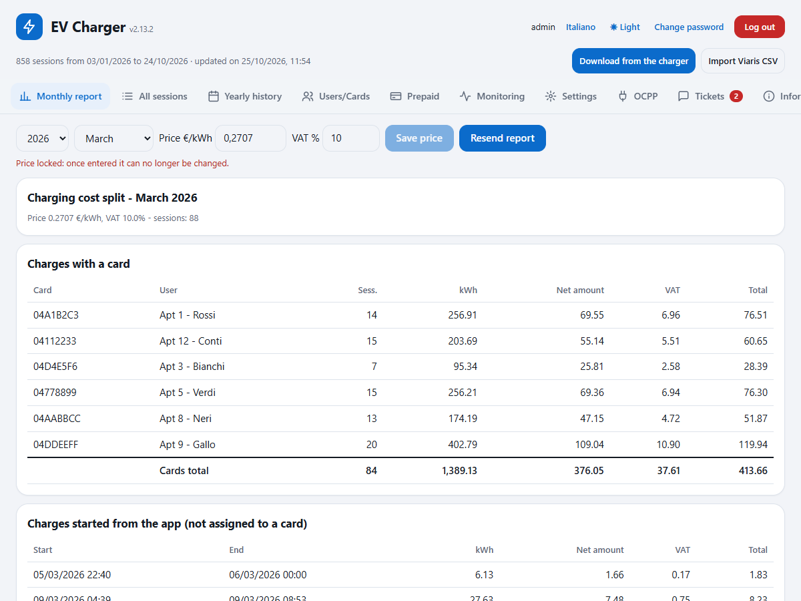 | 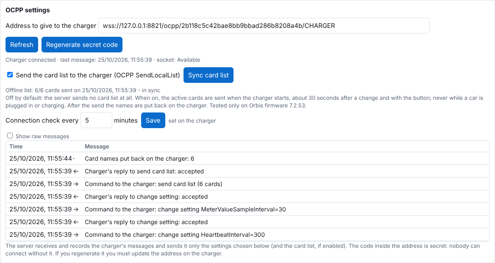 |

| Monitoring (administrator) | Settings |
|---|---|
| 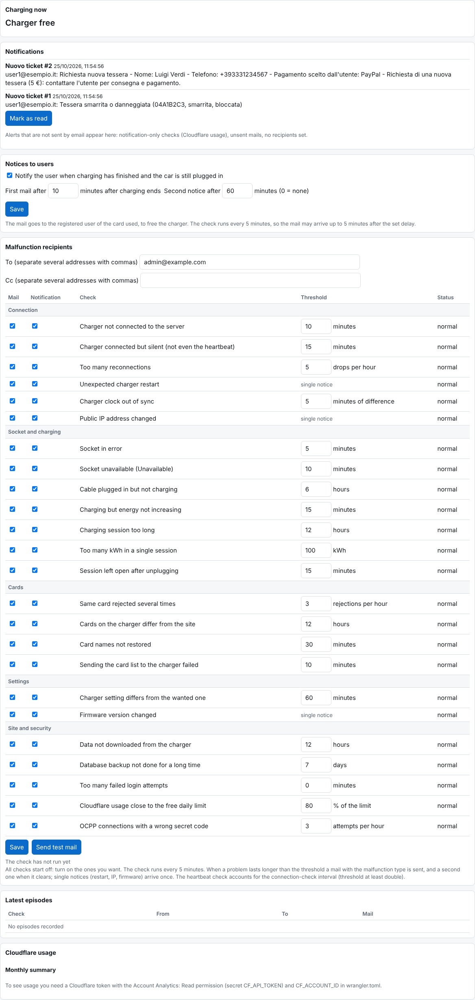 | 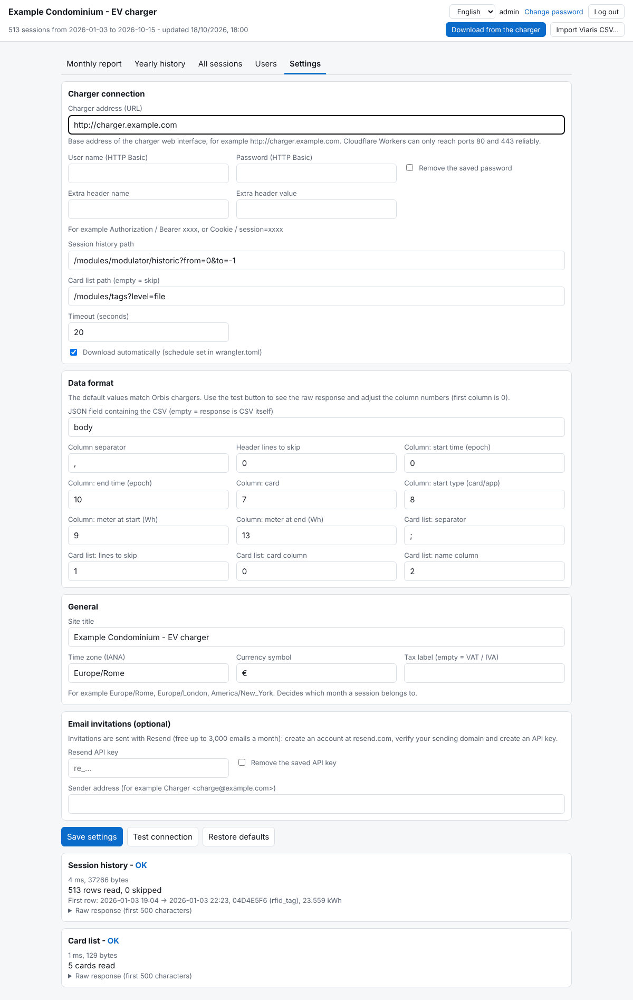 |

| Users | Support (user) and tickets (administrator) |
|---|---|
| 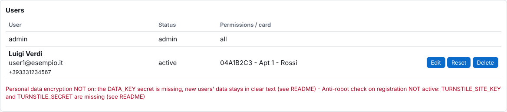 | 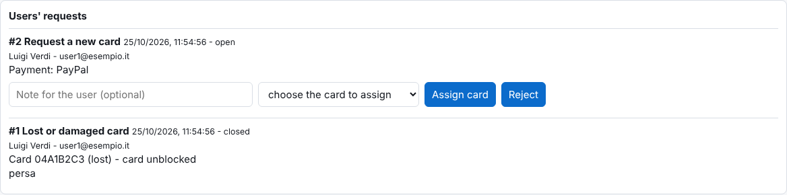 |

| Sign-in and registration | First-run setup |
|---|---|
| 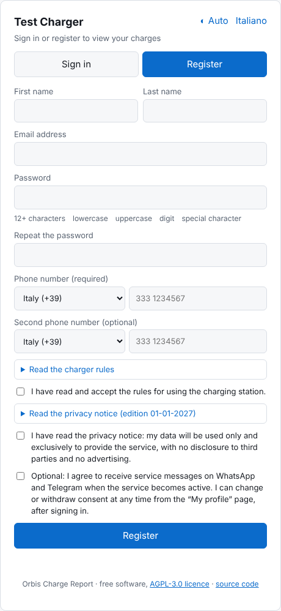 | 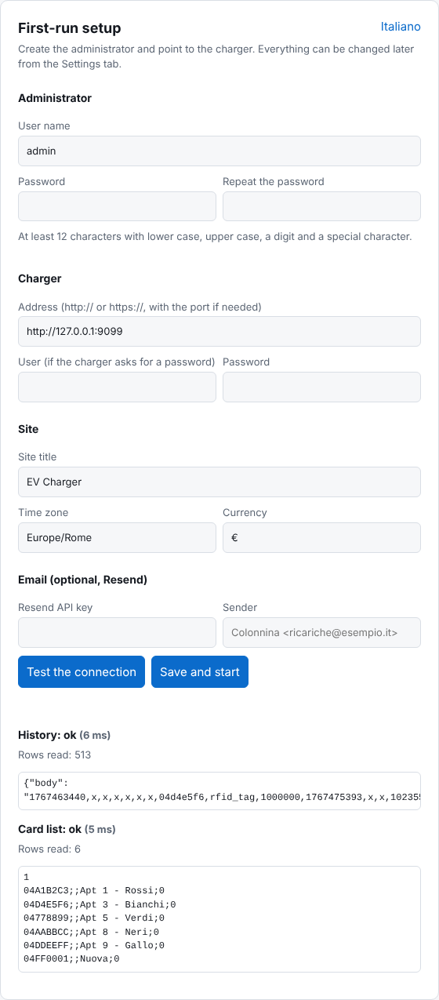 |

| Italian interface | A charger user sees only their own cards |
|---|---|
| 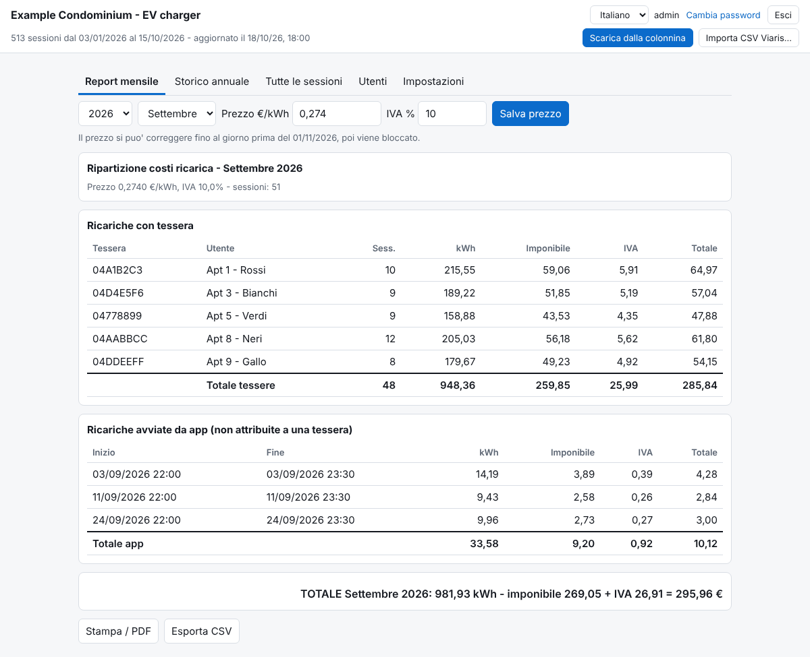 | 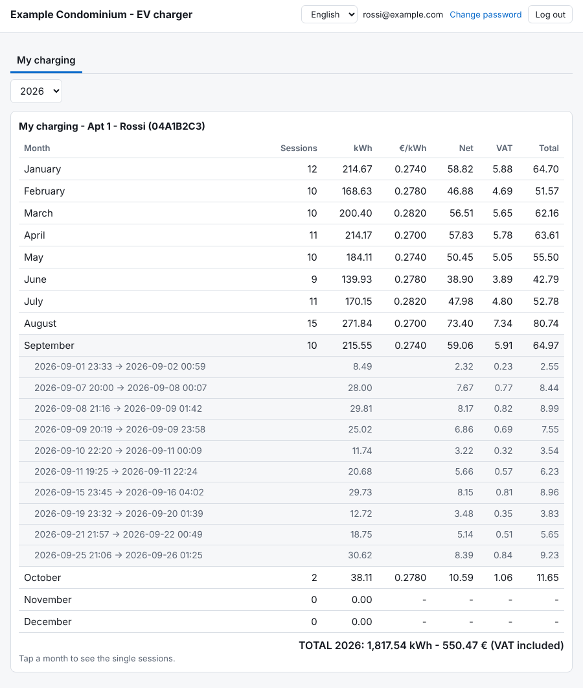 |

| On a phone: monthly report, "More" menu, monitoring, a user's charges |
|---|
| 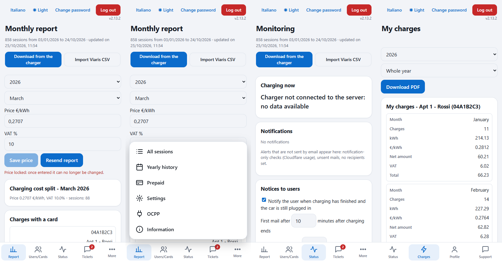 |

## Tested hardware

Developed and used with this station (as shown in the station's own "Station information" screen):

| Item | Value |
| --- | --- |
| Firmware version | **7.2.53** (the only version tested) |
| Hardware version | 8.0 |
| Power board firmware / hardware | 3PH_FW_ORB_V06.3 / 3PH_HW_ORB_V6.2 |
| Cortex firmware | 003.005.010 (Dec 2020) |
| Model features | three-phase, RFID enabled, charging power 22080 W, power limit 13800 W |

Other Orbis models or firmware versions may behave differently, in particular with the optional offline card list (SendLocalList) and the card list web pages. Reports of other working (or not working) setups are welcome as issues.

## Requirements

- Node.js 18 or newer and npm.
- A free [Cloudflare](https://dash.cloudflare.com/sign-up) account.
- A charger whose web interface is reachable **from the internet** over HTTP or HTTPS (for example through a DDNS name and a port forward on the router). Workers can reach non-standard ports (such as `:81`) on a host name; avoid bare IP addresses.
- For the OCPP part: a custom domain on Cloudflare (the charger connects over `wss://` on port 443).
- Optional: a [Resend](https://resend.com) account with a verified sending domain, to send emails.

## Install

```
git clone https://github.com/alexxandro87/orbis-viaris-charge-report.git
cd orbis-viaris-charge-report
npm install
npx wrangler login                          # opens the browser, sign in to Cloudflare
cp wrangler.toml.example wrangler.toml
npx wrangler d1 create ricariche            # copy the printed database_id into wrangler.toml
npx wrangler d1 execute ricariche --remote --file=schema.sql
npx wrangler secret put SETUP_CODE          # recommended, see below
npx wrangler deploy                         # prints https://orbis-viaris-charge-report.<you>.workers.dev
```

On Windows PowerShell, if `npx` is blocked, use `npx.cmd`.

**Custom domain:** uncomment the `routes` line in `wrangler.toml` and put your host name there, then `npx wrangler deploy` again. The domain must already be on your Cloudflare account.

**About `SETUP_CODE`:** until the administrator exists, anyone who opens the Worker address could create it. A setup code (any long random string you choose) is asked on the setup page and prevents that. Set it before the first visit. Once the administrator exists the setup page is gone for good.

## First start

Open the Worker address. On a fresh installation you get the **first setup page**:

1. Choose the **administrator user name** and a strong password (at least 12 characters with lower case, upper case, a digit and a special character). Enter the setup code if you set one.
2. Enter the **charger address** (for example `http://my-charger.example-ddns.com:81`) and, if the charger asks for a login, the user and password.
3. Press **Test the connection**: you see whether the history and the card list could be read and a sample of the response.
4. Set the **site title**, **time zone** and **currency**; optionally the Resend key and sender for emails.
5. Press **Save and start**. You are signed in.

Then press **Download from the charger** once (it then runs by itself every 6 hours), open **Settings** to complete the rest (monthly report recipients, card fee, contact, legal texts), and each month enter the price per kWh and VAT from the electricity bill in the Monthly report tab.

## Settings reference

All of these are in the **Settings** tab (administrator only) and are saved in the database. Values saved there win over environment variables.

| Setting | Default | Meaning |
| --- | --- | --- |
| Charger address | empty | Base address with port, for example `http://charger.example.com:81`. Required. |
| User / Password | empty | Sent as HTTP Basic if a user is set. The password is never sent back to the browser. |
| Extra header name / value | empty | One more header on every request to the charger. |
| History path | `/modules/modulator/historic?from=0&to=-1` | Path that returns the session history. |
| Card list path | `/modules/tags?level=file` | Path of the card list (must contain `level=file` for card management). |
| Status path | `/modules/evsm/elements` | Used to write card names back only when the socket is free. Empty = not checked. |
| Timeout | 20 s | Per request. |
| Automatic download | on | Whether the 6-hour scheduled run downloads. |
| Data format (JSON field, separator, rows to skip, columns) | Orbis values | Only for chargers whose history looks different. |
| Site title | `EV Charger` | Pages, emails, PDFs. |
| Time zone | `Europe/Rome` | IANA name. Decides which month a session belongs to. |
| Currency | `€` | Shown next to amounts. |
| Tax label | empty | Empty = "VAT" / "IVA". |
| Card fee | 0 | Shown to users who request a card (0 = not shown). |
| Operator contact | empty | Shown in the profile and the Information tab. |
| Charger identifier | `CHARGER` | Last part of the OCPP address. |
| Resend key / sender | empty | Enable all emails. |
| Legal texts | empty | Rules of use and privacy notice (Italian and English) with an edition, shown on registration and invitation. Written by you. |
| Monthly report recipients | empty | To / CC for the monthly split. Empty = no email. |
| Card payment | empty | PayPal.me / Satispay / Revolut account names offered to users who request a card; cash is always offered. |

## How it talks to the charger

On the tested firmware the charger's own web interface answers plain HTTP requests:

- `GET /modules/modulator/historic?from=0&to=-1` returns JSON like `{"body": "<one CSV line per session>"}`: start (epoch seconds), card code, start type (`rfid_tag`, `app`...), energy meter at start (Wh), end, energy meter at end.
- `GET /modules/tags?level=file` returns the card list: a first line with the version, then `code;expiry;name;state` per card (state 0 accepted, 1 blocked, 2 expired, 3 invalid). The same address accepts a `POST` with the new list, followed by `GET ...level=save`.
- `GET /modules/evsm/elements` returns the socket state (used only to avoid writing cards while a car is plugged in).

Sessions are stored once (primary key = start time + start meter), so downloading the same history again never creates duplicates.

## OCPP: live status, settings and the optional card list

The charger can report in real time to your Worker using OCPP 1.6-J. The Worker runs a small Durable Object (SQLite-backed, free plan) for the connection.

1. Keep the `[[durable_objects.bindings]]` and `[[migrations]]` blocks of `wrangler.toml.example` in your `wrangler.toml` and deploy with a custom domain.
2. Open the **OCPP** tab as administrator and copy the address shown (it contains a secret token).
3. In the charger's OCPP settings enter that address, with OCPP 1.6-J. The tab shows "Charger connected" within a minute.

What it does by default: records the charger's messages (boot, heartbeat, status, authorisation, start/stop, measures) in a readable log, shows who is charging and the live measures, and lets the administrator send read-only commands (GetConfiguration, GetLocalListVersion, TriggerMessage), stop the running charge and restart an idle charger. A few settings can be changed from the page (heartbeat, connection timeout, ping, retries, measure intervals, "listed cards valid when the server is unreachable"): only the values you set are sent, when you save and again after every restart.

When the charger asks the server to authorise a card, only a card present on the charger's list in state accepted (or, for a lost card, not blocked by a ticket) is accepted.

**Offline card list (SendLocalList), optional, OFF by default.** With the option off the server never sends any card list to the charger. When the administrator turns it on (OCPP tab), the server sends the list of active cards to the charger: at the charger's start, about 30 seconds after a change to the cards, and with the "Sync card list" button; in blocks of 10 cards; never while a car is plugged in or charging (the send is postponed until the socket is free). The charger rewrites its own list without names, so the names are put back afterwards from the database. Blocked cards stay on the list as blocked so they can be unblocked later. This has only been tried on firmware 7.2.53.

## Cards on the charger and card holders

**Settings > Charger RFID cards** (administrator) shows the cards the charger accepts and lets you add, edit (name, expiry, state), permanently deactivate, import (from the file exported here or from the Viaris CSV), export and restore the list saved before the last change. The list is read from the card list path, written back and saved as the Orbis panel does; before each change the current list is stored, and after writing the list is read again to check it (names up to 25 characters).

Card holders: every card has a history of who held it and when; reports use the holder at the time of each session. A card deactivated and later reassigned starts a new period; dates can be corrected from the same box.

## Users: invitations, self-registration, profile

The administrator sees and does everything. Other users are either invited or register by themselves.

- **Invitation** (Users tab): enter the email and choose a *manager* (pick permissions) or a *charger user* (one card plus optional other cards). The user receives a single-use link, valid 48 hours, where they choose a strong password and fill in name, phone numbers and consents. If email is not configured the page shows the link to send by hand.
- **Self-registration** (Register tab on the sign-in page): name, surname, email, strong password, one or two phone numbers with international prefix, acceptance of the rules and privacy notice (the edition is recorded with date and time), optional consent to WhatsApp/Telegram service messages (the messages themselves are not sent yet; only the consent is collected). A confirmation email (48-hour link) is required; after confirming, the user can sign in. If they already have a card, the administrator links it from Users ("Activate account") and they receive the "Service activation" email; otherwise they see only Support and My profile and can request a card. Rate-limited (5 registrations per 10 minutes per address) with an anti-bot trap; the response is the same whether the email exists or not.
- **Complete your profile**: users created before the data collection must fill in the same data at their next sign-in.
- **My profile**: name, email, phones, and the WhatsApp / Telegram consents, which can be changed or withdrawn at any time (the last 20 changes are kept with date and time).

Requires Resend for the registration emails: without email, registration is refused and invitations show the link instead.

**Anti-bot check (Cloudflare Turnstile), optional:** on dash.cloudflare.com open *Turnstile*, add a widget for your domain (Managed mode), put the **Site Key** in `wrangler.toml` as `TURNSTILE_SITE_KEY` and the **Secret Key** in the secret `TURNSTILE_SECRET`, then deploy. The registration form then shows the verification box; without the keys the site registers as before and the Users tab shows a warning.

## Support tickets

From the **Support** tab a user opens a request: lost or damaged card, new card request, data correction, deletion of data or account, charger problem, other. Up to 5 open requests, one open card request; details can be added while the request is open. The administrator handles them from the **Tickets** tab (badge with the open count): approve, reject or close, with a note; the user gets the outcome by email.

- **Lost or damaged card**: the card is **blocked on the charger at once** (if the charger does not answer, the block is retried every 5 minutes). The administrator can replace it ("Replace card", with or without a new one) or, if found, "Found: unblock and close". Blocked cards remain on the charger's list as blocked.
- **New card**: shows the fee and the payment options you configured (PayPal.me with the amount preset, Satispay, Revolut, cash on delivery) and a ready reference; the administrator receives the user's name, phone and chosen payment, and assigns the card from the ticket. The site does not verify the payment.
- **Data correction**: if approved, the data is updated.
- **Deletion**: if approved, the account and personal data are deleted; the consumption data stays (the ticket becomes anonymous).

For card, charger and new-card tickets the administrator also gets an email (monitoring recipients); the others only an in-site notification.

## Monitoring, notifications and reminders

The **Monitoring** tab shows the charge in progress to everyone. For the administrator it also holds:

- **Malfunction recipients and checks**: 24 checks grouped by area (connection, socket and charges, cards, settings, site and security), for example charger not connected, no messages, too many reconnections, unexpected restart, clock drift, public IP changed, socket in error or unavailable, cable plugged without charging, energy not increasing, charge too long or too big, charge left open, same card refused repeatedly, cards on the charger differing from the site, names not restored, card list send failed, setting different from the wanted one, firmware changed, data not downloaded, backup too old, too many failed sign-ins, OCPP connections with a wrong token, Cloudflare usage near the limit. **Every check is off until you enable it**, each with Mail and Notification boxes and a threshold. The checks run every 5 minutes (second cron in `wrangler.toml`). An email goes out when a problem starts and another when it ends; single events (restart, IP, firmware) once. "Send test email" checks the recipients.
- **Notifications**: in-site alerts (unread counter on the tab) for checks set to "Notification", for emails that could not be sent, for registrations to activate and new tickets.
- **Reminders to users**: email to the user whose card charged when the charge is over but the car is still plugged in (first after 10 minutes, a reminder after 60; both configurable, can be turned off). One email per charge.
- **Last episodes**: history with start and end of each problem.

## Cloudflare usage

With a Cloudflare API token with permission "Account Analytics: Read" (secret `CF_API_TOKEN`) and `CF_ACCOUNT_ID` in `wrangler.toml`, the Monitoring tab shows the last 7 days of requests, errors, CPU, D1 rows read/written, OCPP requests, duration and rows, each with the percentage of the free-plan daily limit, a monthly summary, and the storage used by D1 and the Durable Object. The "Cloudflare usage near the limit" check (threshold 80 %) is the only one enabled by default, as a notification. Without the token the box explains what is missing.

## Encryption of personal data

Set the `DATA_KEY` secret (32 random bytes in base64) and first name, last name, phone numbers, consents and ticket texts are stored encrypted (AES-256-GCM, each value bound to its row and field). Existing data is encrypted by itself. Without the key the site works with data in clear and shows a warning in the Users tab. From Settings you can also download an **encrypted backup** (passphrase, PBKDF2 + AES-256-GCM) and decrypt it with `decifra_backup.mjs`. Details in [docs/ENCRYPTION.md](docs/ENCRYPTION.md).

## Prices, VAT and the month lock

Enter price per kWh and VAT for each month from the electricity bill, whenever the bill arrives. As soon as a month's price is saved the month is **locked** and cannot be changed again, administrator included (the page asks for confirmation first). If report recipients are set, saving the price emails the split per card with a PDF of every session; "Email report again" sends it once more. At the same moment every charger user who charged that month gets a personal email (Italian and English) with their own amounts only: price, VAT and, for each of their cards, sessions, kWh, net, VAT and total. It is always on, with no setting to turn it off; it is not sent to users with no sessions that month or who have not yet confirmed their email, "Email report again" does not resend it, and at most 40 are sent per save (free-plan limit; if some fail or exceed it the administrator gets a notification). Charger users see a note on months without a price.

Emergency correction of a locked month, from a terminal:

```
npx wrangler d1 execute ricariche --remote --command "UPDATE prezzi SET eur_kwh=0.2531, iva=10 WHERE anno=2026 AND mese=10"
```

## Importing Viaris CSV files

If you previously used the Viaris desktop program, press **Import Viaris CSV** and select its per-card exports (one file per card, plus one named `U ...` for sessions started from the app). The card is recognised from the first word of the file name, so download from the charger first. Importing is repeatable and creates no duplicates.

## Pushing data from outside (ingest API)

If the Worker cannot reach the charger at all, a computer that can reach it can push the raw responses instead, with the credentials of a user who may download:

```
curl -u admin:YOUR_PASSWORD https://YOUR-WORKER/api/ingest \
  -H "content-type: application/json" \
  -d "{\"storico\": $(jq -Rs . < history.txt), \"tessere\": $(jq -Rs . < tags.txt)}"
```

`history.txt` and `tags.txt` are the exact bodies returned by the two charger URLs. HTTP Basic is accepted only on this endpoint.

## Secrets and environment variables

Nothing has to be set except what you want. Prefer the web page; use these for automation or if you do not want a value in the database.

| Name | Kind | Purpose |
| --- | --- | --- |
| `SETUP_CODE` | secret | Protects the first-run page. Recommended. |
| `RESEND_API_KEY` | secret | Email sending (or enter it in Settings). |
| `DATA_KEY` | secret | Encryption of personal data. Keep a copy outside Cloudflare. |
| `CF_API_TOKEN` + `CF_ACCOUNT_ID` | secret + variable | Cloudflare usage box. |
| `TURNSTILE_SECRET` + `TURNSTILE_SITE_KEY` | secret + variable | Anti-bot check on registration (Cloudflare Turnstile). |
| `CHARGER_URL`, `CHARGER_USER`, `CHARGER_PASSWORD`, `TIMEZONE`, `CURRENCY`, `SITE_TITLE`, `MAIL_FROM` | variable / secret | Defaults, overridden by saved settings. |
| `APP_PASSWORD` | secret | Legacy: creates the user `admin` with this password and skips the setup page. |

Set a secret with `npx wrangler secret put NAME`.

## Backups

From the page: **Settings > Database backup** (administrator): encrypted backup with a passphrase, or the plain dump at `/api/backup`. From a terminal: `npx wrangler d1 export ricariche --remote --output backup.sql`. Restore with `npx wrangler d1 execute ricariche --remote --file=backup.sql`. D1 also keeps 7 days of point-in-time history. The dump contains the saved charger password and Resend key: keep it private. The "backup too old" monitoring check reminds you.

## Local development

```
cp .dev.vars.example .dev.vars
npx wrangler d1 execute ricariche --local --file=schema.sql
npx wrangler dev
```

## Troubleshooting

| Symptom | Likely cause and fix |
| --- | --- |
| "no answer within 20 s" or a network error | The Worker cannot reach the charger: check the DDNS name, the port forward and the port in the address. Try the URL from another network. |
| "HTTP 401" / "HTTP 403" | The charger wants a login: set the user and password or an extra header. |
| "The history response is not JSON" | The response is CSV directly: empty the JSON field setting. |
| Wrong cards or energy | Column numbers differ: use Test the connection, read the raw response, fix the columns in "Data format". |
| Sessions land in the wrong month | Wrong time zone setting. |
| Emails not sent | Check the Resend key, that the sender domain is verified, and the error shown on the page. Invitation links are always shown so you can send them manually. |
| Registration refused with "could not send the confirmation email" | Email is not configured: self-registration needs Resend. |
| Charger not connected (OCPP) | Check the custom domain, the address on the charger (with the token) and that the charger uses OCPP 1.6-J. |
| The setup page does not appear | An administrator already exists (or `APP_PASSWORD` is set). |

## Security notes

- Passwords are hashed with PBKDF2-SHA-256; the iteration count is deliberately low (5000) to stay inside the free plan's CPU limit, so strong passwords are enforced (12+ characters with lower case, upper case, digit and symbol) on registration, invitation and password change.
- Sign-in is rate-limited per user name and IP address together (5 errors in 10 minutes, so wrong passwords sent from elsewhere cannot lock the real user out), per user name from all addresses (50 errors in 10 minutes) and per IP address (20 errors in 10 minutes); the same limit applies to password changes and registrations. Session cookies are `HttpOnly`, `Secure`, `SameSite=Strict`; every sign-in gets a different signed token; log out revokes it on the server.
- Every response carries security headers: HTTPS redirect, HSTS, a Content Security Policy with a per-response nonce (only the site's own scripts run; the only external service allowed is Turnstile), `X-Frame-Options: DENY`, `frame-ancestors 'none'`, `X-Content-Type-Options: nosniff`, `Referrer-Policy: no-referrer`.
- All user-entered text (names, tickets, card names) is escaped when shown. Without a session every API answers 401; the OCPP endpoint answers 404 to anyone without the token.
- HTTP Basic authentication is accepted only on `/api/ingest`.
- Towards the charger the server sends only: the few OCPP settings you change, the read-only commands you press, stop/restart on request, and, **only if you enable the option**, the list of active cards. It never sends charging profiles, current limits or a server address.
- Personal data can be encrypted at rest (`DATA_KEY`): names, phones, consents, ticket texts and notification details. The charger password and Resend key are stored in D1 (never shown again in the page); set them as secrets if you prefer.
- The charger link is plain HTTP on most of these stations, so credentials sent to it are not encrypted in transit. **Mind the charger's own web panel**: if it is exposed on the internet without a password, anyone who finds the address can read and change cards and settings. Restrict it on the router (allow only Cloudflare, or use a Cloudflare Tunnel) and keep the OCPP connection as the charger's way out.
- This was written for a small private group. Review it before exposing it to untrusted users.

## Limits

- One charger, one socket, one price per month.
- Card management and the offline list are built around the Orbis web interface and OCPP behaviour of firmware 7.2.53.
- WhatsApp / Telegram messages are not sent: only the consent is collected.
- Internal names (functions, API fields) are in Italian for historical reasons; code comments, user interface, emails and documentation are in English and Italian.

## License

Copyright (C) 2026 Alessandro Pomponi. Licensed under the **GNU Affero General Public License v3.0 or later** (AGPL-3.0-or-later), see [LICENSE](LICENSE).

In short: you can use, study, modify and share this software, including for your own building or business. If you distribute a modified version, or let other people use a modified version over a network (for example by hosting it as a service), you must make the source code of your modified version available to those users under the same license (section 13). Using it unmodified for your own condominium requires nothing more than keeping the license and copyright notices. This summary is not legal advice; the license text is what counts.
