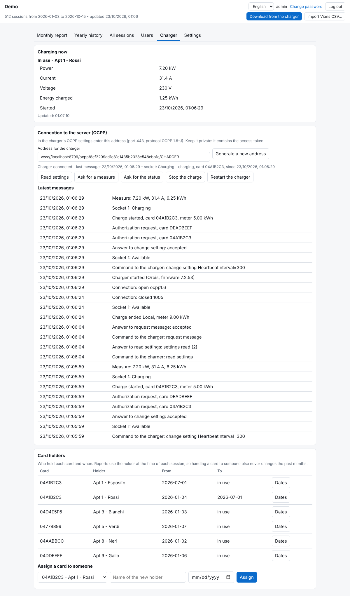

# Orbis Charge Report

**English** | [Italiano](README.it.md)

A small, free web app that downloads the session history from an **Orbis** EV charging station, stores it for good, and produces monthly and yearly cost-sharing reports per RFID card, with price per kWh and VAT. It was built for condominiums where several people share one charger and the building has to split the electricity bill. It works from a phone or a PC, with no Windows software, and runs on the Cloudflare free tier (one Worker plus one D1 database).

> Unofficial community project, not affiliated with or endorsed by Orbis or Viaris. Product names are used only to describe compatibility.

## Contents

- [Features](#features)
- [Screenshots](#screenshots)
- [Tested hardware](#tested-hardware)
- [Requirements](#requirements)
- [Install](#install)
- [First start](#first-start)
- [Settings reference](#settings-reference)
- [How it talks to the charger](#how-it-talks-to-the-charger)
- [Using it with another charger](#using-it-with-another-charger)
- [Live status over OCPP](#live-status-over-ocpp-optional)
- [Users and permissions](#users-and-permissions)
- [Prices, VAT and the month lock](#prices-vat-and-the-month-lock)
- [Importing Viaris CSV files](#importing-viaris-csv-files)
- [Pushing data from outside (ingest API)](#pushing-data-from-outside-ingest-api)
- [Secrets and environment variables](#secrets-and-environment-variables)
- [Backups](#backups)
- [Local development](#local-development)
- [Troubleshooting](#troubleshooting)
- [Security notes](#security-notes)
- [Limits](#limits)
- [License](#license)

## Features

- **Automatic download** from the charger every 6 hours, plus a manual button. The charger itself only keeps its last ~100 sessions; the database keeps everything.
- **Monthly report and yearly history** per card with net amount, VAT and total; print to PDF and CSV export.
- **Cost splitting that adds up**: amounts are split in cents with the largest-remainder method, so the sum of the single sessions always equals the card total.
- **Sessions started from the app** (no RFID card) are kept in a separate section that only authorised users see.
- **Monthly price entry** (price per kWh and VAT) that locks automatically once the month is closed.
- **Monthly report by email**: when a month's price is saved, the split per card is emailed to the recipients you choose, with a PDF of every session attached (via Resend).
- **PDF downloads**: charger users can download a PDF of their own sessions for a month or a whole year.
- **One-click backup**: the administrator can download a `.sql` dump of the whole database from the Settings tab.
- **Users and permissions**: email + password, per-user permissions, single-use invitation links (optionally emailed through [Resend](https://resend.com)). A "charger user" account is bound to one card and sees only its own sessions.
- **First-run setup page**: creates the administrator and collects everything needed to reach the charger.
- **Everything configurable from the web page**: charger URL, credentials, URL paths, response format and column numbers, time zone, currency, tax label, site title, email.
- **Live charging status (OCPP 1.6)**: the "Charger" tab shows whether the charger is connected, who is charging now, power, current, voltage and energy in real time. The charger connects to your Worker; nothing is sent to it except the commands you press (read settings, ask for a measure, stop the charge, restart).
- **Card holders with dates**: record who held each card and when. Reports use the holder at the time of each session, so handing a card to someone else never rewrites past months.
- **Card list on the charger (Orbis)**: read, add, edit, block, remove and restore the cards the charger accepts, straight from the web page. The list is saved before every change and read back to check it.
- **English and Italian interface** with a language switch (also on the sign-in page, invitations and emails).
- Optional import of the per-card CSV exports of the Viaris desktop program.

## Screenshots

All screenshots use made-up demo data.

**Monthly report** - per-card totals, single sessions on click, app sessions in their own section:


**Live charger status** - connection, who is charging now, power and energy in real time, plus the card holders box:



| Yearly history | All sessions |
|---|---|
|  |  |

| Users and permissions | A charger user sees only their own card |
|---|---|
|  |  |

| First-run setup with connection test | Settings |
|---|---|
|  |  |

| Italian interface | Sign-in |
|---|---|
|  |  |

## Tested hardware

Developed and used with this station (as shown in the station's own "Station information" screen):

| Item | Value |
| --- | --- |
| Firmware version | 7.2.53 |
| Hardware version | 8.0 |
| Power board firmware / hardware | 3PH_FW_ORB_V06.3 / 3PH_HW_ORB_V6.2 |
| Cortex firmware | 003.005.010 (Dec 2020) |
| Model features | three-phase, RFID enabled, charging power 22080 W, power limit 13800 W |

Other Orbis models or firmware versions may expose the same pages with different columns: see [Using it with another charger](#using-it-with-another-charger). Reports of other working (or not working) setups are welcome as issues.

## Requirements

- Node.js 18 or newer and npm.
- A free [Cloudflare](https://dash.cloudflare.com/sign-up) account.
- A charger whose web interface is reachable **from the internet** over HTTP or HTTPS. Cloudflare Workers can only be relied on to reach ports **80 and 443**.
  - If the charger sits behind a router with a changing public IP (for example a SIM router), use a dynamic DNS name (DDNS) and a port forward.
  - Use a host name rather than a bare IP address: Workers may refuse requests to raw IPs.
- Optional: a [Resend](https://resend.com) account and a verified sending domain, to email invitations.

## Install

```
git clone https://github.com/alexxandro87/orbis-charge-report.git
cd orbis-charge-report
npm install
npx wrangler login                          # opens the browser, sign in to Cloudflare
cp wrangler.toml.example wrangler.toml
npx wrangler d1 create ricariche            # copy the printed database_id into wrangler.toml
npx wrangler d1 execute ricariche --remote --file=schema.sql
npx wrangler secret put SETUP_CODE          # recommended, see below
npx wrangler deploy                         # prints https://orbis-charge-report.<you>.workers.dev
```

On Windows PowerShell, if `npx` is blocked, use `npx.cmd`.

**Custom domain (optional):** uncomment the `routes` line in `wrangler.toml` and put your host name there, then `npx wrangler deploy` again. The domain must already be on your Cloudflare account.

**About `SETUP_CODE`:** until the administrator exists, anyone who opens the Worker address could create it. A setup code (any long random string you choose) is asked on the setup page and prevents that. Set it before the first visit. Once the administrator exists the setup page is gone for good.

## First start

Open the Worker address. On a fresh installation you get the **first setup page**:

1. Enter the **setup code** (if you set one).
2. Choose the **administrator user name** and password (at least 8 characters).
3. Enter the **charger address** (for example `http://my-charger.example-ddns.com`), and, if the charger asks for a login, the HTTP Basic user and password, or an extra header.
4. Press **Test connection**: you will see whether the history and the card list could be downloaded, how many rows were read, the first row decoded and the raw response. If the rows are wrong, adjust the column numbers later in the Settings tab.
5. Set the **site title**, **time zone** (for example `Europe/Rome`, `Europe/London`, `America/New_York`) and **currency symbol**.
6. Optional: a **Resend API key** and a **sender address** to email invitations.
7. Press **Create administrator and finish**. You are signed in.

Then press **Download from the charger** once (it then runs by itself every 6 hours), and each month enter the price per kWh and VAT from the electricity bill in the Monthly report tab.

## Settings reference

All of these are in the **Settings** tab (administrator only) and are saved in the database. Values saved there win over environment variables.

| Setting | Default | Meaning |
| --- | --- | --- |
| Charger address (URL) | empty | Base address, for example `http://charger.example.com`. Required. |
| User name / Password (HTTP Basic) | empty | Sent as `Authorization: Basic ...` if a user name is set. The password is stored in the database and never sent back to the browser. |
| Extra header name / value | empty | One more header on every request, for example `Authorization` / `Bearer xxxx` or `Cookie` / `session=xxxx`. |
| Session history path | `/modules/modulator/historic?from=0&to=-1` | Path (and query) that returns the session history. |
| Card list path | `/modules/tags?level=file` | Path that returns the card list. Empty = skip (cards then show only their code). |
| Timeout | 20 s | Per request. |
| Download automatically | on | Whether the scheduled run downloads. The schedule itself is in `wrangler.toml`. |
| JSON field with the CSV | `body` | The history response is JSON and this field holds the CSV text. Empty = the response itself is CSV. |
| Column separator | `,` | Separator of the history CSV. |
| Header lines to skip | 0 | Lines to ignore at the top of the history CSV. |
| Columns (start, end, card, type, meter start, meter end) | 0, 10, 7, 8, 9, 13 | 0-based column numbers in a history row. Times are epoch seconds, meters are Wh. |
| Card list: separator / lines to skip / card column / name column | `;` / 1 / 0 / 2 | Layout of the card list text. |
| Site title | `EV Charger` | Shown in pages, reports and emails. |
| Time zone | `Europe/Rome` | IANA name. Decides which month a session belongs to and when prices lock. |
| Currency symbol | `€` | Shown next to totals. |
| Tax label | empty | Empty = "VAT" in English, "IVA" in Italian. |
| Resend API key / sender | empty | Enable emails (invitations and monthly reports). The key is never sent back to the browser. |
| Monthly report recipients (To / CC) | empty | Comma-separated addresses that receive the monthly split with the PDF when a price is saved. Empty To = no report email. |

## How it talks to the charger

On the tested firmware the charger's own web interface answers two plain HTTP GET requests, which is all this app uses:

- `GET /modules/modulator/historic?from=0&to=-1` returns JSON like `{"body": "<one CSV line per session>"}`. Each line has comma-separated fields; the app reads column 0 (start, epoch seconds), 7 (card code), 8 (start type, such as `rfid_tag` or `app`; sessions started from the app are the ones without a card), 9 (energy meter at start, Wh), 10 (end, epoch seconds) and 13 (energy meter at end, Wh). Energy of a session = meter at end - meter at start.
- `GET /modules/tags?level=file` returns plain text: a first line with the list version, then one card per line, separated by `;`, with the card code in column 0 and the owner name in column 2.

Sessions are stored once (primary key = start time + start meter), so downloading the same history again never creates duplicates. Card codes are matched case-insensitively. If a Viaris import and a charger download describe the same session, the duplicate is removed.

## Live status over OCPP (optional)

The charger can report in real time to your Worker using OCPP 1.6-J. The Worker runs a small Durable Object (SQLite-backed, available on the free plan) for the connection.

1. Keep the `[[durable_objects.bindings]]` and `[[migrations]]` blocks of `wrangler.toml.example` in your `wrangler.toml` and deploy again. The charger needs to reach the Worker over `wss://` on port 443, so use a custom domain.
2. Open the **Charger** tab as administrator and copy the address shown (it contains a secret token).
3. In the charger's OCPP settings enter that address, with OCPP 1.6-J. The tab shows "Charger connected" within a minute.

What it does: shows live status and measures, lists the latest messages, and lets the administrator read the settings, ask for a measure or status, stop the running charge and restart an idle charger. What it does not do: it never sends a card list or a charging profile, and the monthly reports keep coming from the history download. When the charger asks the server to authorize a card, only a card already in the list downloaded from the charger is accepted; unknown cards are refused. Permission "live" lets a manager see who is charging now. "Generate a new address" invalidates the old token.

### Cards on the charger

The "Cards on the charger" box (Charger tab, administrator) shows the cards the charger accepts and lets you add, edit (name, expiry, state accepted / blocked / expired / invalid) and remove them, or put back the list saved before the last change. It uses the Orbis web interface, not OCPP: the list is read from the **Card list path** of the Settings (it must contain `level=file`), written back to the same address and saved with `level=save`. Before each change the current list is stored in the database, and after writing the list is read again to check that the charger kept it (the charger keeps names up to 25 characters). The cards are also copied to the local card table, which feeds the reports and the OCPP card check, and a card added with a "holder since" date starts its holder period on that day. This only works with the Orbis card list format (`code;expiry;name;state`).

### Card holders

The "Card holders" box (Charger tab, administrator) lists who held each card and from/to which date. Names coming from the charger create the first period automatically. To hand a card to someone else, choose the card, type the name and the start date: the previous period is closed that day. The dates of a period can be corrected with "Dates". Periods you edit are never overwritten by later downloads. A charger user bound to a card sees only the sessions of the card's current holder.

## Using it with another charger

Nothing about the format is hard-coded. If your charger (or firmware) returns the history in a different shape, open **Settings**, press **Test connection** and read the raw response shown there, then change:

- the paths, if the URLs differ;
- the JSON field (or leave it empty if the response is CSV directly);
- the separator, header lines to skip and column numbers.

The only assumptions left are: one session per line, start and end as epoch seconds, and energy meters in Wh. If your device reports something else, open an issue with a sample (remove personal data) or send a pull request; the parser is the two small functions `parseStorico` and `parseTessere` in `src/index.js`.

## Users and permissions

The administrator sees and does everything. Other users are created in the **Users** tab by entering an email address and either:

- **Manager**: pick what the user may do: see the monthly report, the yearly history, all sessions; enter price and VAT; print and export; download from the charger and import CSV; see sessions started from the app.
- **Charger user**: linked to one card; sees only that card's sessions (month by month, with amounts) and nothing else, and can download them as a PDF.

Pressing **Send invitation** emails a personal single-use link, valid 48 hours, to choose the password. If email is not configured, or sending fails, the page shows the link so you can send it yourself. "Reset" / "Resend" creates a new link. Passwords can be changed by each user from the header.

## Prices, VAT and the month lock

Enter price per kWh and VAT for each month from the electricity bill. If report recipients are set in Settings, saving the price emails the split per card with a PDF of every session (the administrator can send it again with **Email report again**). A month's price can be entered and corrected until the end of the following month, then it locks: for example the October price can be changed until 30 November and is locked from 1 December, for everyone including the administrator. A month with no price can still be filled in once. The point is that closed reports cannot change afterwards.

Emergency correction of a locked month, from a terminal:

```
npx wrangler d1 execute ricariche --remote --command "UPDATE prezzi SET eur_kwh=0.2531, iva=10 WHERE anno=2026 AND mese=10"
```

## Importing Viaris CSV files

If you previously used the Viaris desktop program, press **Import Viaris CSV...** and select its per-card exports (one file per card, plus one named `U ...` for sessions started from the app). The card is recognised from the first word of the file name, so download from the charger first (that is what provides the card list). Importing is repeatable and creates no duplicates. Dates in those files are read as local time in the configured time zone.

## Pushing data from outside (ingest API)

If the Worker cannot reach the charger at all, a computer that can reach it can push the raw responses instead. Send the two responses as text to the Worker with the credentials of a user who may download:

```
curl -u admin:YOUR_PASSWORD https://YOUR-WORKER/api/ingest \
  -H "content-type: application/json" \
  -d "{\"storico\": $(jq -Rs . < history.txt), \"tessere\": $(jq -Rs . < tags.txt)}"
```

`history.txt` and `tags.txt` are the exact bodies returned by the two charger URLs. They are parsed with the same settings as a normal download.

## Secrets and environment variables

Nothing has to be set except what you want. Prefer the web page; use these for automation or if you do not want a value in the database.

| Name | Kind | Purpose |
| --- | --- | --- |
| `SETUP_CODE` | secret | Protects the first-run page. Recommended. |
| `CHARGER_URL`, `TIMEZONE`, `CURRENCY`, `SITE_TITLE`, `MAIL_FROM` | variable | Defaults, overridden by saved settings. |
| `CHARGER_USER`, `CHARGER_PASSWORD`, `RESEND_API_KEY` | secret | Defaults, overridden by saved settings. |
| `APP_PASSWORD` | secret | Legacy: creates the user `admin` with this password and skips the setup page. |

Set a secret with `npx wrangler secret put NAME`.

## Backups

From the page: **Settings > Database backup > Download backup (.sql)** (administrator only). From a terminal:

```
npx wrangler d1 export ricariche --remote --output backup.sql
```

Restore either file with `npx wrangler d1 execute ricariche --remote --file=backup.sql`.

Schedule it with cron or Task Scheduler. D1 also keeps 7 days of point-in-time history (`npx wrangler d1 time-travel restore ricariche --timestamp=<ISO date>`). Note that the export contains the saved charger password and Resend key: keep it private.

## Local development

```
cp .dev.vars.example .dev.vars
npx wrangler d1 execute ricariche --local --file=schema.sql
npx wrangler dev
```

## Troubleshooting

| Symptom | Likely cause and fix |
| --- | --- |
| "timeout after 20 s" or a network error | The Worker cannot reach the charger: check the DDNS name, the router port forward and that you use port 80 or 443. Try the URL from another network. |
| "HTTP 401" / "HTTP 403" | The charger wants a login: set the HTTP Basic user and password or an extra header. |
| "The history response is not JSON" | The response is CSV directly: empty the JSON field setting. |
| Rows read but "skipped" is high, or wrong cards/energy | Column numbers differ: use Test connection, read the raw response, fix the columns. |
| Sessions land in the wrong month | Wrong time zone setting. |
| Invitation email not sent | Check the Resend key, that the sender domain is verified, and the error text shown on the Users tab. The link is always shown so you can send it manually. |
| The setup page does not appear | An administrator already exists (or `APP_PASSWORD` is set). |

## Security notes

- Passwords are hashed with PBKDF2-SHA-256; the iteration count is deliberately low (5000) to stay inside the free plan's CPU limit. Use long passwords.
- Sign-in is rate-limited (5 attempts per 10 minutes per user name). Session cookies are `HttpOnly`, `Secure`, `SameSite=Strict`; every sign-in gets a different signed token.
- **Log out** also cancels the session on the server (the token is revoked, not just the cookie deleted). Changing a password or deleting a user ends all of that user's sessions.
- Every response carries security headers: plain HTTP is redirected to HTTPS, HSTS, `X-Frame-Options: DENY` and `frame-ancestors 'none'` (no embedding in other sites), `X-Content-Type-Options: nosniff`, `Referrer-Policy: no-referrer` (invitation links never leak).
- HTTP Basic authentication is accepted only on `/api/ingest`, never for the pages.
- The charger password and Resend key are stored in the D1 database (not shown again in the page). If that is not acceptable, set them as Worker secrets instead.
- The charger link is plain HTTP on most of these stations, so credentials sent to it are not encrypted in transit. Prefer a dedicated, read-only account if the charger supports it.
- This was written for a small private group. Review it before exposing it to untrusted users.

## Limits

- Reports are for a single charger and a single price per month.
- Live status uses one charger connection (one socket); the card list is managed only for the Orbis web interface (see "Cards on the charger").
- The scheduled download interval is set in `wrangler.toml` (default every 6 hours).
- Code comments and internal names are partly Italian for historical reasons; the user interface and messages are bilingual.

## License

Copyright (C) 2026 Alessandro Pomponi. Licensed under the **GNU Affero General Public License v3.0 or later** (AGPL-3.0-or-later), see [LICENSE](LICENSE).

In short: you can use, study, modify and share this software, including for your own building or business. If you distribute a modified version, or let other people use a modified version over a network (for example by hosting it as a service), you must make the source code of your modified version available to those users under the same license (section 13). Using it unmodified for your own condominium requires nothing more than keeping the license and copyright notices. This summary is not legal advice; the license text is what counts.
